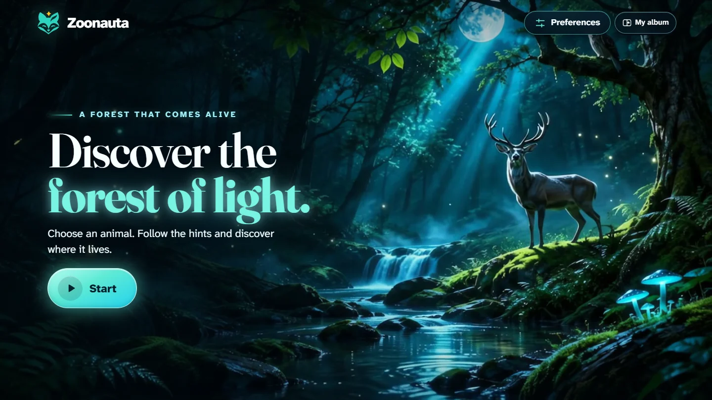
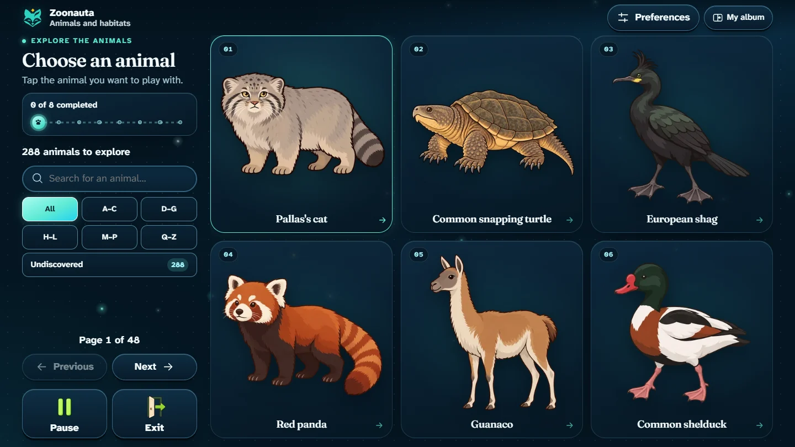
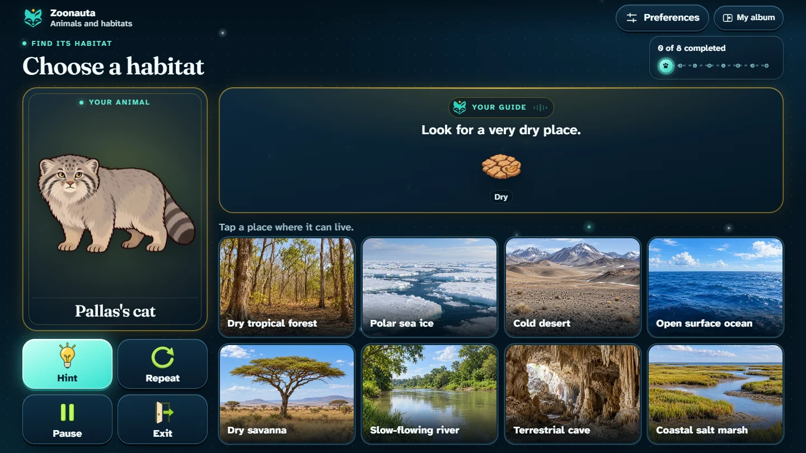
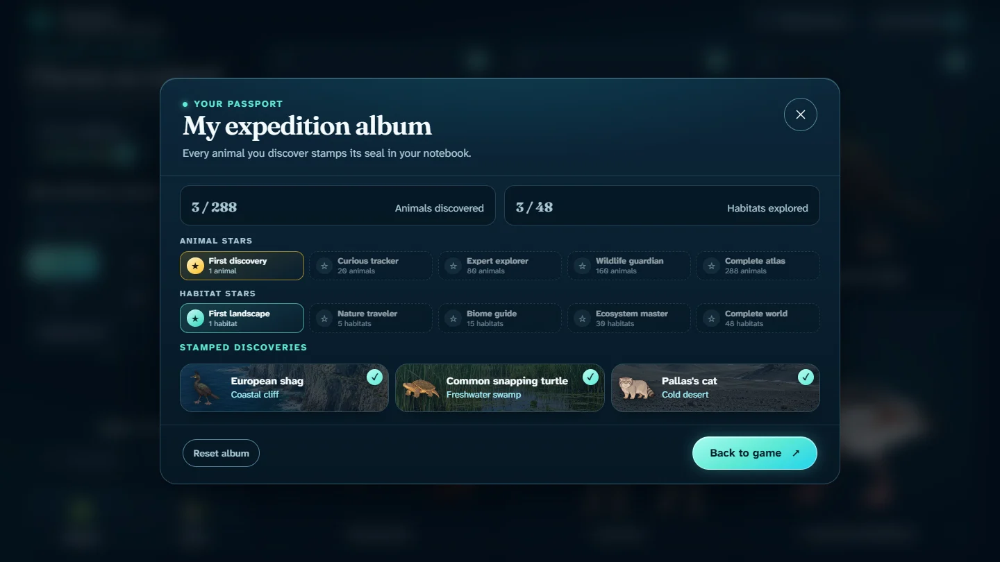
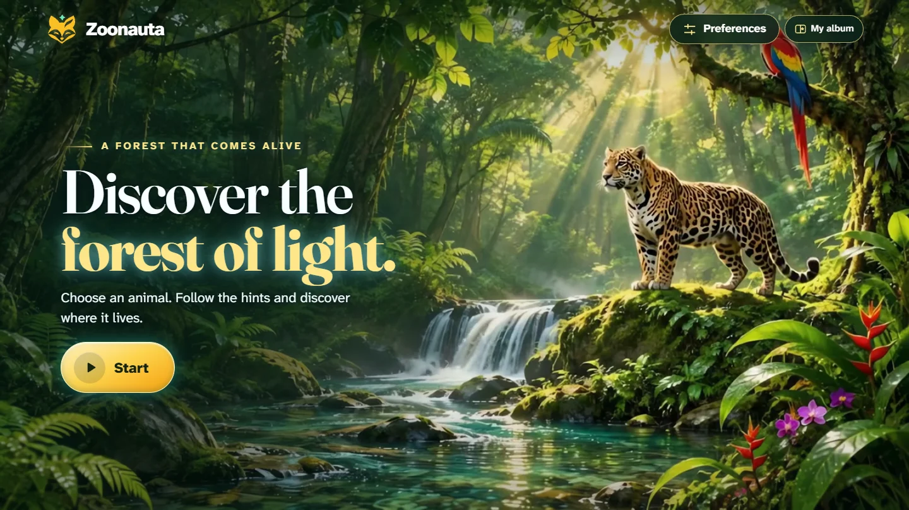
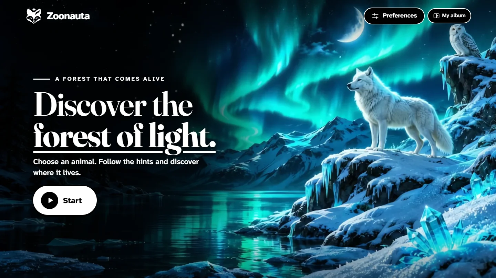

<div align="center">

<picture>
  <source media="(prefers-color-scheme: dark)" srcset="docs/interfaz/readme/logo-dark.svg" />
  <source media="(prefers-color-scheme: light)" srcset="docs/interfaz/readme/logo-light.svg" />
  
</picture>

<br />

**Choose an animal. Follow the hints and discover where it lives.**

Educational animal & habitat discovery game with AAC pictograms, a local adaptive AI guide, and 8 complete recorded voices.

<p>
  <a href="https://matarojo.pythonanywhere.com/"><strong>Play now</strong></a>
  &nbsp;&middot;&nbsp;
  <a href="#gallery">Gallery</a>
  &nbsp;&middot;&nbsp;
  <a href="#how-to-play">How to play</a>
  &nbsp;&middot;&nbsp;
  <a href="#languages--voices">Languages &amp; voices</a>
  &nbsp;&middot;&nbsp;
  <a href="#running-locally">Run locally</a>
</p>

<p>
  
  
  
  
  
  
</p>

<p>
  <a href="README.md">Español</a> &nbsp;|&nbsp; <a href="README.pt-BR.md">Português (Brasil)</a> &nbsp;|&nbsp; <strong>English</strong>
</p>

</div>

---

<p align="center">
  
</p>

## Gallery

<table>
  <tr>
    <td width="50%">
      
      <p align="center"><strong>288-animal catalog</strong><br />Biome-interleaved random discovery order, A–Z letter filters, instant search, and an <em>Undiscovered</em> filter.</p>
    </td>
    <td width="50%">
      
      <p align="center"><strong>Adaptive hints with AAC pictograms</strong><br />A local AI guide picks the clearest hint for the visible habitats, with no timers or penalties.</p>
    </td>
  </tr>
  <tr>
    <td colspan="2">
      <p align="center">
        
      </p>
      <p align="center"><strong>My expedition album</strong><br />Personal browser-saved passport with two 5-star milestone tracks (animals &amp; habitats) and a 3 × 3 paginated stamp book.</p>
    </td>
  </tr>
</table>

### Three adaptive visual themes

<table>
  <tr>
    <td width="33.3%" align="center">
      
      <br /><strong>Night forest</strong><br /><sub>Bioluminescent observatory (default)</sub>
    </td>
    <td width="33.3%" align="center">
      
      <br /><strong>Day forest</strong><br /><sub>Warm light editorial theme</sub>
    </td>
    <td width="33.3%" align="center">
      
      <br /><strong>High contrast</strong><br /><sub>Pure black &amp; white WCAG AAA 21:1</sub>
    </td>
  </tr>
</table>

---

## How to play

Tap **Start** and choose who picks the animal:

- **I choose:** browse all **288 animals** six at a time. *All* and *Undiscovered* shuffle animals across distinct biomes each game; letter filters (`A–C` through `Q–Z`) and search sort alphabetically. Solved animals show a `✓` seal.
- **The guide chooses:** prioritizes animals not yet discovered in your album and smoothly reshuffles all 288 once completed. Choose from **1 to 48 challenges** per game.

Each challenge shows the animal on the left alongside **Hint**, **Repeat**, **Pause**, and **Exit**; on the right, the guide displays text + AAC pictograms above **2, 4, or 8 habitat cards**. Finding a matching habitat stamps it into **My album** with a gentle biome-reactive chime.

---

## Languages & voices

Zoonauta translates the entire UI, all **288 animals**, **48 habitats**, AAC pictogram labels, hints, confirmations, and your expedition album live. It ships with **8 complete recorded voices** (`412` messages per voice · `3,296` audio files total) that work completely offline:

| Language | Available voices | Audio clips per voice |
| :--- | :--- | :---: |
| **Español (`es-419`)** | Marcela, Valeria, Gaby, Diego | 412 |
| **Português (`pt-BR`)** | Roberta, Will | 412 |
| **English (`en`)** | Jessica, Mark | 412 |

The server natively serves **AAC (`.m4a` / `audio/mp4`)** — used at 32 kbps mono in `Zoonauta-Web.zip` — as well as **MP3** and **WAV**.

---

## Accessibility & preferences

- **Text size:** *Small*, *Normal*, and *Large*.
- **Reduce motion:** respects `prefers-reduced-motion` and swaps videos/animations for sharp static visuals.
- **Lock Preferences:** optional press-and-hold lock to prevent accidental setting changes.
- **Forest sounds & haptics:** gentle ambient soundscape, 5 biome celebration families (ocean, freshwater, forest, mountain, savanna), calm pause melody, and victory fanfare — automatically ducked while the voice guide speaks.
- **Installable PWA:** includes a web manifest and service worker (*Install app* in Preferences).

---

## Running locally

### Desktop (Windows / Linux / macOS)

Requires only **Python 3.10+** (the server uses Python's standard library with zero external dependencies):

```console
# Windows
iniciar_juego.bat
# or via terminal:
py -3 -m codigo.interfaz.iniciar

# Linux / macOS
python3 -m codigo.interfaz.iniciar
```

The game opens at `http://127.0.0.1:8766` (technical inspector at `/revision`). To pick another port:

```console
py -3 -m codigo.interfaz.servidor --puerto 8080
```

### Web deployment (Hostinger / WSGI / Docker)

- **Ready-to-deploy web bundle:** download **`Zoonauta-Web.zip`** (~71 MB) from [Releases](https://github.com/Matador-Rojo/Zoonauta/releases). Includes the compiled frontend, lightweight images, and all 8 voices in 32 kbps AAC (`.m4a`).
- **Zero-dependency WSGI:** `codigo.interfaz.wsgi:application` (works with Hostinger, Gunicorn, and PythonAnywhere).
- **Docker:** `Dockerfile` and `docker-compose.yml` included in the repository root.

---

## Project structure & tests

- `codigo/motores/` & `codigo/entrenamiento/`: local adaptive agent, `ID3` baseline, Beta-Bernoulli selector, and simulator.
- `codigo/nucleo/`, `codigo/respuestas/` & `codigo/interfaz/`: game state machine, AAC generator, HTTP/WSGI server, and compiled frontend (`web6/`).
- `frontend/`: React 19 + TypeScript + Vite application.
- `datos/` & `assets/`: validated catalog, `pt-BR` and `en` translations, SHA-256 manifest, illustrations, pictograms, voices, and backgrounds.
- `docs/` & `tests/`: documentation, reproducible experiments, and automated tests.

```console
python -m unittest discover -s tests -v
python -m codigo.nucleo.verificar_paquete
npm --prefix frontend run check
```

## Credits

Original animal illustrations, support pictograms, and landscapes generated with AI under **CC BY-NC-SA 4.0**. See [docs/creditos_pictogramas.md](docs/creditos_pictogramas.md) and [docs/manual_usuario.md](docs/manual_usuario.md) for details.
