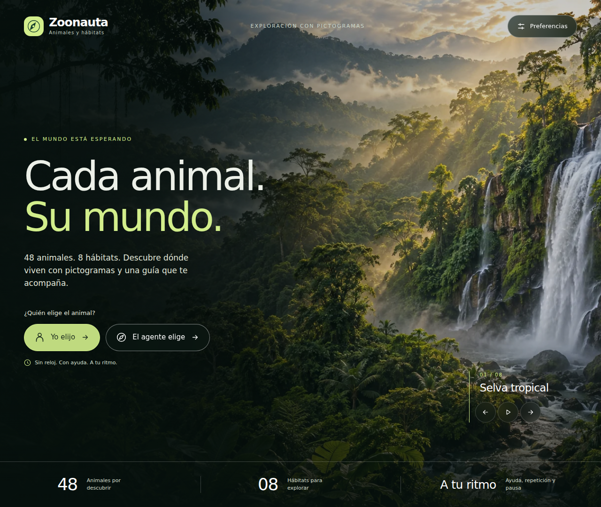

# Zoonauta

Juego de animales y hábitats con pictogramas y guía de inteligencia artificial.

Versión 3.4.0. Español y portugués brasileño. Voces locales Piper y Kokoro.



Clona este repositorio o descarga y extrae su ZIP. Abre la terminal en la carpeta
que contiene `codigo`, `datos`, `docs`, `assets` y `tests`. Al extraer el ZIP en
Windows, esa carpeta puede quedar dentro de otra `Zoonauta-main`. Para jugar:

En Windows abre **iniciar_juego.bat**. En Linux/macOS ejecuta
`bash iniciar_juego.sh`. También puedes iniciarlo desde una terminal:

```console
py -3 -m codigo.interfaz.iniciar
```

En Linux/macOS utiliza `python3` en lugar de `py -3`. El iniciador prepara un
entorno aislado con Python 3.12, los motores y los modelos, y abre
http://127.0.0.1:8766. Puedes conservar tu Python 3.14: el juego prepara su propia
versión compatible. Mantén la terminal abierta; Ctrl+C detiene el servidor.

La primera preparación requiere Internet y descarga unos **656 MB de modelos**,
además de Python y las dependencias que falten. Las descargas se verifican por
huella y tamaño. Si se interrumpen, vuelve a abrir el iniciador: conserva los
archivos completos comprobados. Después puedes jugar y escuchar las voces sin
conexión, claves de API ni cuentas adicionales.

Para usar otro puerto:

```console
iniciar_juego.bat --puerto 8767
```

Para actualizar una copia descargada como ZIP, detén el servidor, descarga el ZIP
actual y extrae la nueva versión. Puedes copiar la carpeta `modelos_voz` de la
versión anterior para evitar descargarla otra vez; el iniciador la comprobará.
Un ZIP anterior no se actualiza automáticamente.

Abre **Preferencias → Idioma** para elegir Español o Português (Brasil). Cambian
los controles, los 48 nombres de animales, los ocho hábitats, las etiquetas de
pictogramas, las pistas, las confirmaciones y las voces. Puedes cambiar durante
una partida conservando su estado y progreso. El selector muestra siete opciones
por idioma, agrupadas por motor; **Probar voz** reproduce una muestra. La selección
manual se conserva por idioma mientras la página está abierta. Las voces anteriores
del navegador se sustituyeron por estos motores locales.

| Idioma | Motor | Opciones |
|---|---|---|
| Español | Piper | Claude (México), Ald (México, media y ligera), Daniela (Argentina) |
| Español | Kokoro | Dora, Alex, Santa |
| Português (Brasil) | Piper | Cadu, Edresson, Faber, Jeff |
| Português (Brasil) | Kokoro | Dora, Alex, Santa |

Ald ofrece dos variantes del mismo hablante. El ZIP contiene el catálogo y el
instalador; los pesos grandes se descargan al preparar el juego. Consulta
[la guía de voces](docs/interfaz/alternativas_voz.md) y
[la guía de interfaz](docs/guia_interfaz.md).

El inicio ocupa una sola pantalla, sin desplazamiento vertical. Sus ocho fotografías
cambian cada 10 segundos; el nombre y el contador acompañan a cada fondo. Puedes
pausar o recorrer los paisajes con los controles inferiores. Preferencias y la pestaña
inactiva detienen temporalmente el cambio; con movimiento reducido empieza pausado.
La selva es ahora un paisaje sin el guacamayo y comparte el estilo de los otros siete.
Los botones de inicio y el diálogo usan la misma paleta oscura con acentos lima.
El catálogo permite buscar
animales por nombre, incluso sin tildes. El tablero separa el animal, la guía y los
ocho hábitats, que combinan paisajes decorativos y sus pictogramas originales;
el progreso indica retos completados. Se adapta a móvil y admite
selección con teclado. No necesita vídeos, GIF ni recursos visuales externos.
Puedes ver el [tablero de juego](docs/interfaz/03_reto_escritorio.png) y el
[inicio en móvil](docs/interfaz/06_inicio_movil.png).

La interfaz carga el modelo sintético contextual R01, congelado, elegido por su
posición como primera réplica y no por su rendimiento. Para revisar los registros
de la sesión abre http://127.0.0.1:8766/revision en el mismo navegador.

Otros comandos desde esta carpeta, que contiene codigo, datos, docs, assets y tests:

```console
python -m codigo.poc.consola --modalidad JUGADOR --retos 2
python -m codigo.interfaz.servidor --politica ID3 --puerto 8001
python -m codigo.interfaz.servidor --politica ROTACION --puerto 8002
python -m codigo.poc.consola --modalidad AGENTE --retos 2
python -m codigo.entrenamiento.experimento --salida resultados_nuevos
python -m codigo.poc.aceptacion
python -m unittest discover -s tests -v
```

El núcleo conserva 48 animales, ocho opciones por reto y ambas modalidades.
No hay puntos competitivos ni límite de tiempo o intentos. ID3 construye el árbol
calculando ganancias. Se ejecutó aprendizaje probabilístico con interacciones
sintéticas y evaluación separada: 34 560 retos de entrenamiento, 51 840 de
evaluación. Las evidencias actuales están en `docs/interfaz/revision_navegador.json` y
`docs/interfaz/revision_voces_locales.json`.

La consola utiliza los priors originales salvo que indiques un modelo con
--parametros; conserva sus parámetros congelados durante la sesión.
El simulador y el informe no requieren paquetes externos. Volver a exportar
el PNG mediante --grafico requiere matplotlib; el gráfico ya está incluido.

Esta versión contiene el código, los datos, los modelos, la interfaz y sus imágenes.
Se comprobó síntesis real de las 14 opciones con WAV PCM no silencioso y
repetición idéntica desde caché. Esa prueba no certifica pronunciación ni sonido
audible en otros dispositivos. La comprensión CAA de las secuencias requiere validación
con usuarios. Los documentos V1/V2 son antecedentes; esta guía y la de interfaz
describen el estado actual. Los experimentos conservan su procedencia sintética.

Créditos: 28 PNG ARASAAC sin modificación, Sergio Palao, Gobierno de Aragón,
CC BY-NC-SA; 67 SVG originales del prototipo, CC BY-NC-SA 4.0.
Consulta `docs/creditos_pictogramas.md` y `datos/fuentes_pictogramas.json`.
La portada y los ocho paisajes son imágenes decorativas generadas con IA,
incluidas en nueve archivos WebP: ocho fondos de inicio y un atlas para el tablero. No forman parte de los 95 pictogramas educativos.
Las referencias visuales, los prompts y las rutas están en
`docs/interfaz/diseno_visual.md`. El mapa SVG anterior se conserva como antecedente.
