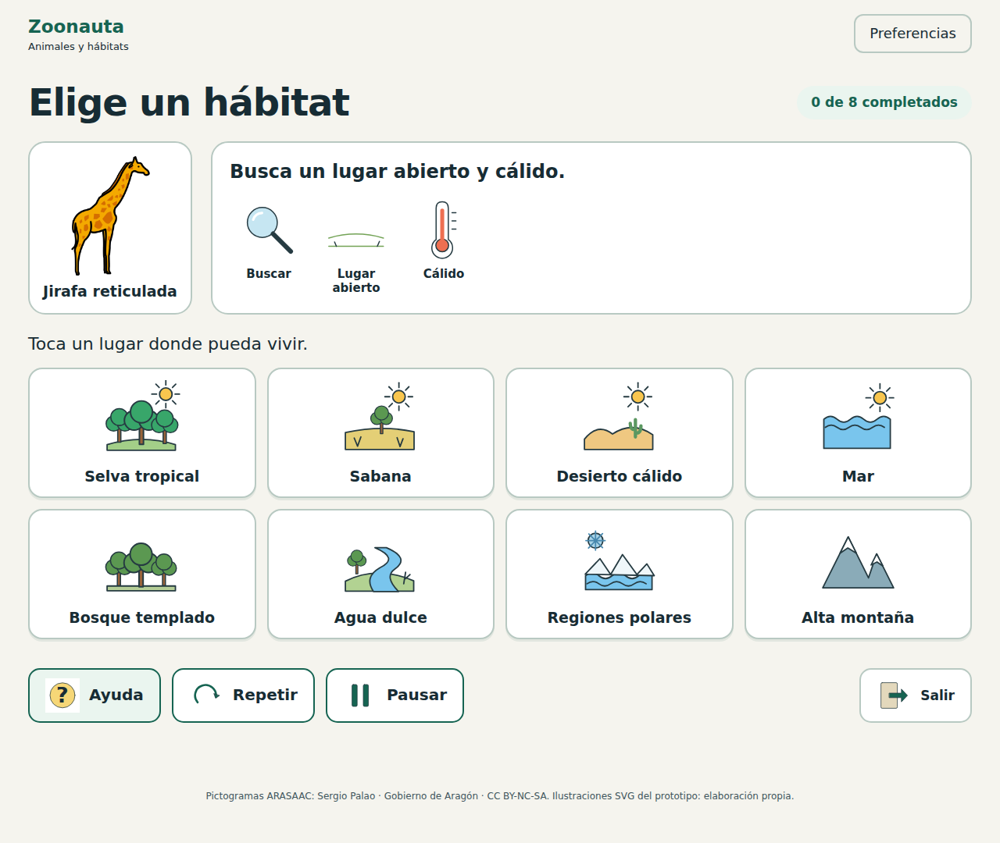

# Zoonauta

Juego de animales y hábitats con pictogramas y guía de inteligencia artificial.

Versión 3.0.0 · 9 de octubre de 2026. Python 3.10 o superior.



Clona este repositorio o descarga y extrae su ZIP. Abre la terminal en esta carpeta. Para jugar:

```console
python -m codigo.interfaz.servidor --abrir
```

En Windows puedes usar `py` en lugar de `python`. Si el navegador no se abre,
entra en http://127.0.0.1:8000. Mantén la terminal abierta; Ctrl+C detiene el servidor.
No necesitas instalar paquetes de Python para jugar.

Abre `docs/guia_interfaz.md` para los comandos, alcance y evidencias actuales.
La pantalla incluye selección por clic/toque, 95 imágenes, texto, síntesis de voz,
Ayuda, Repetir, Pausar, Reanudar, Continuar y Salir. Preferencias permite elegir
de 1 a 48 retos antes del inicio y ajustar la voz. La voz requiere una voz española
disponible en el dispositivo; si falta, se muestra un aviso y continúa el juego.
El ZIP no contiene voces instalables ni audio grabado.

La interfaz carga el modelo sintético contextual R01, congelado, elegido por su
posición como primera réplica y no por su rendimiento. Para revisar los registros
de la sesión abre http://127.0.0.1:8000/revision en el mismo navegador.

Otros comandos desde esta carpeta, que contiene codigo, datos, docs, assets y tests:

```console
python -m codigo.poc.consola --modalidad JUGADOR --retos 2
python -m codigo.interfaz.servidor --politica ID3 --puerto 8001
python -m codigo.interfaz.servidor --politica ROTACION --puerto 8002
python -m codigo.poc.consola --modalidad AGENTE --retos 2
python -m codigo.entrenamiento.experimento --salida resultados_nuevos
python -m codigo.poc.aceptacion
python -m unittest discover -s tests -v
```

El núcleo conserva 48 animales, ocho opciones por reto y ambas modalidades.
No hay puntos competitivos ni límite de tiempo o intentos. ID3 construye el árbol
calculando ganancias. Se ejecutó aprendizaje probabilístico con interacciones
sintéticas y evaluación separada: 34 560 retos de entrenamiento, 51 840 de
evaluación. Ahora hay 35 pruebas de Python y siete casos de navegador correctos.

La consola utiliza los priors originales salvo que indiques un modelo con
--parametros; conserva sus parámetros congelados durante la sesión.
El simulador y el informe no requieren paquetes externos. Volver a exportar
el PNG mediante --grafico requiere matplotlib; el gráfico ya está incluido.

Esta versión contiene el código, los datos, los modelos, la interfaz y sus imágenes.
La voz se probó con una síntesis controlada en navegador; no certifica sonido audible
en otros dispositivos. La comprensión CAA de las secuencias requiere validación
con usuarios. Los documentos V1/V2 son antecedentes; esta guía y la de interfaz
describen el estado actual. Los experimentos conservan su procedencia sintética.

Créditos: 28 PNG ARASAAC sin modificación, Sergio Palao, Gobierno de Aragón,
CC BY-NC-SA; 67 SVG originales del prototipo, CC BY-NC-SA 4.0.
Consulta `docs/creditos_pictogramas.md` y `datos/fuentes_pictogramas.json`.
