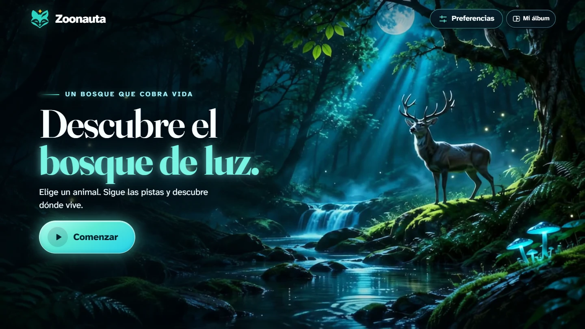
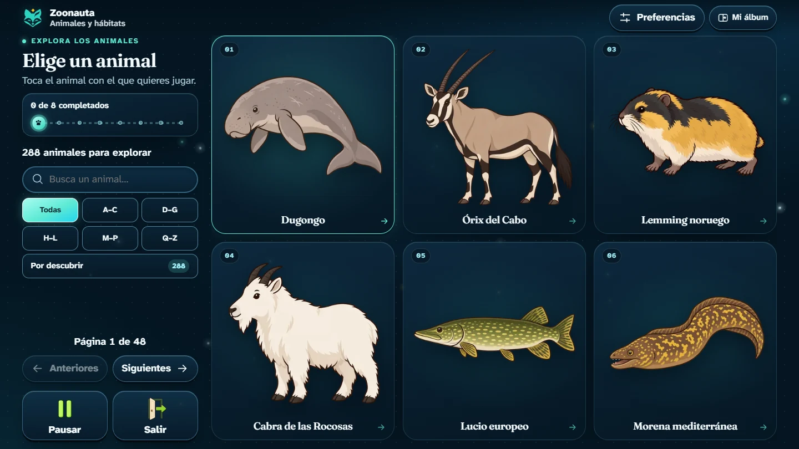
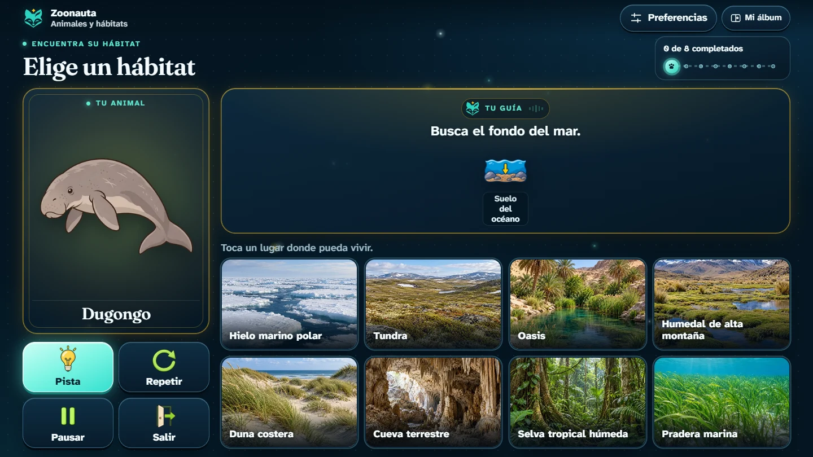
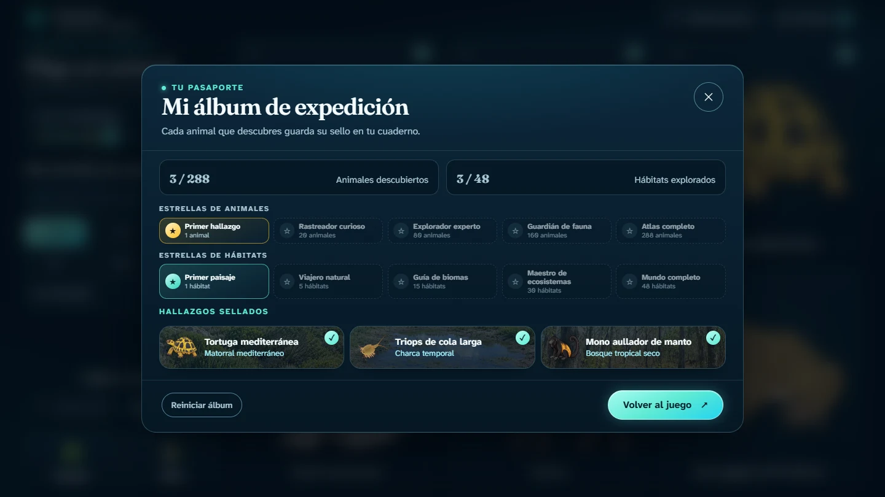
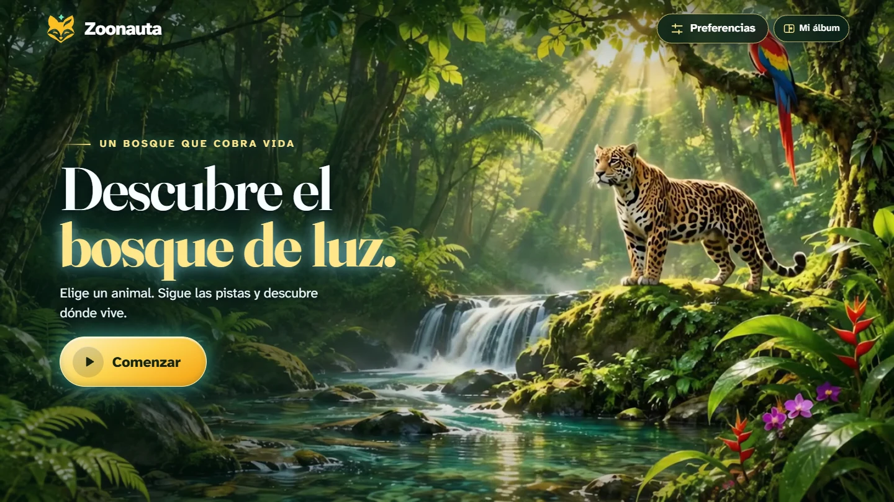
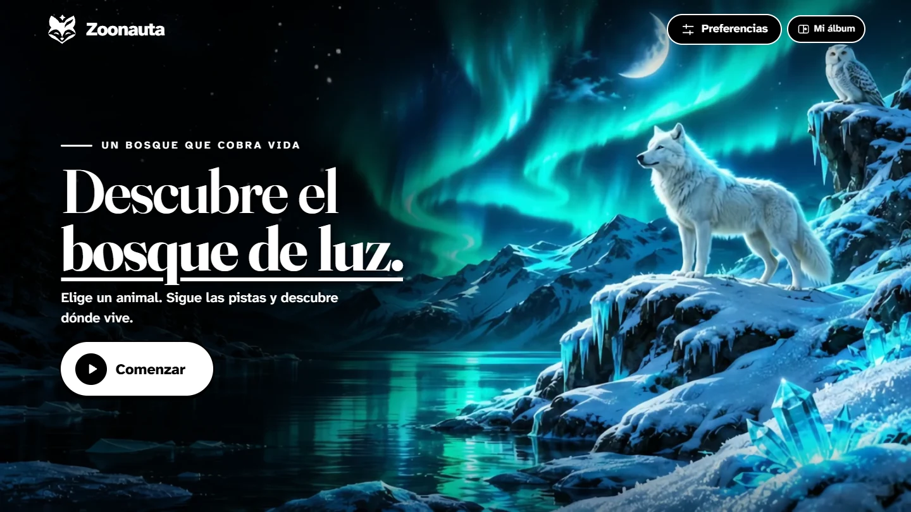

<div align="center">

<picture>
  <source media="(prefers-color-scheme: dark)" srcset="docs/interfaz/readme/logo-dark.svg" />
  <source media="(prefers-color-scheme: light)" srcset="docs/interfaz/readme/logo-light.svg" />
  
</picture>

<br />

**Elige un animal. Sigue las pistas y descubre dónde vive.**

Juego educativo de animales y hábitats con pictogramas CAA, guía adaptativa local y 8 voces grabadas completas.

<p>
  <a href="https://github.com/Matador-Rojo/Zoonauta/releases"><strong>Descargar Zoonauta-Web.zip</strong></a>
  &nbsp;&middot;&nbsp;
  <a href="#galería">Galería</a>
  &nbsp;&middot;&nbsp;
  <a href="#cómo-se-juega">Cómo se juega</a>
  &nbsp;&middot;&nbsp;
  <a href="#idiomas-y-voces">Idiomas y voces</a>
  &nbsp;&middot;&nbsp;
  <a href="#ejecutar-el-juego">Ejecutar</a>
</p>

<p>
  
  
  
  
  
  
</p>

<p>
  <strong>Español</strong> &nbsp;|&nbsp; <a href="README.pt-BR.md">Português (Brasil)</a> &nbsp;|&nbsp; <a href="README.en.md">English</a>
</p>

</div>

---

<p align="center">
  
</p>

## Galería

<table>
  <tr>
    <td width="50%">
      
      <p align="center"><strong>Catálogo de 288 animales</strong><br />Orden variado por biomas, filtros alfabéticos, buscador y filtro <em>Por descubrir</em>.</p>
    </td>
    <td width="50%">
      
      <p align="center"><strong>Pistas adaptativas con pictogramas CAA</strong><br />El agente elige la ayuda más útil según las opciones visibles, sin reloj ni castigos.</p>
    </td>
  </tr>
  <tr>
    <td colspan="2">
      <p align="center">
        
      </p>
      <p align="center"><strong>Mi álbum de expedición</strong><br />Pasaporte personal guardado en el navegador con 2 series de 5 estrellas (animales y hábitats) y colección paginada 3 × 3.</p>
    </td>
  </tr>
</table>

### Tres temas visuales adaptativos

<table>
  <tr>
    <td width="33.3%" align="center">
      
      <br /><strong>Bosque de noche</strong><br /><sub>Observatorio bioluminiscente (predeterminado)</sub>
    </td>
    <td width="33.3%" align="center">
      
      <br /><strong>Bosque de día</strong><br /><sub>Tema claro editorial con paleta solar</sub>
    </td>
    <td width="33.3%" align="center">
      
      <br /><strong>Alto contraste</strong><br /><sub>WCAG AAA 21:1 en blanco y negro puro</sub>
    </td>
  </tr>
</table>

---

## Cómo se juega

Pulsa **Comenzar** y elige quién escoge el animal:

- **Yo elijo:** explora los **288 animales** en páginas de 6. En *Todas* y *Por descubrir* se muestran biomas intercalados en orden aleatorio renovado en cada partida; en los filtros `A–C` a `Q–Z` y el buscador se ordenan alfabéticamente. Los animales ya descubiertos llevan sello `✓`.
- **El agente elige:** prioriza automáticamente los animales aún no descubiertos en tu álbum y, al completar los 288, vuelve a mezclar todo el catálogo de forma continua. Configura entre **1 y 48 retos** por partida.

En cada reto verás el animal a la izquierda con **Pista**, **Repetir**, **Pausar** y **Salir**; a la derecha, la guía con frase de apoyo + pictogramas CAA y **2, 4 u 8 hábitats** para elegir. Al acertar, el hábitat se marca con `✓`, se guarda el sello en **Mi álbum** y suena una celebración acústica propia del bioma.

---

## Idiomas y voces

Zoonauta traduce en vivo toda la interfaz, los **288 animales**, los **48 hábitats**, las etiquetas CAA, las pistas, las confirmaciones y el álbum. Incluye **8 voces grabadas completas** (`412` mensajes por voz · `3 296` audios totales) que funcionan sin Internet ni APIs externas:

| Idioma | Voces disponibles | Audios por voz |
| :--- | :--- | :---: |
| **Español (`es-419`)** | Marcela, Valeria, Gaby, Diego | 412 |
| **Português (`pt-BR`)** | Roberta, Will | 412 |
| **English (`en`)** | Mark, Jessica | 412 |

El servidor soporta **AAC (`.m4a` / `audio/mp4`)** —usado a 32 kbps mono en `Zoonauta-Web.zip`—, **MP3** y **WAV**.

---

## Accesibilidad y preferencias

- **Tamaño de texto:** *Pequeño*, *Normal* y *Grande*.
- **Reducir movimiento:** respeta `prefers-reduced-motion` y sustituye videos y transiciones por vistas estáticas nítidas.
- **Proteger Preferencias:** bloqueo opcional de pulsación prolongada para evitar cambios accidentales.
- **Sonidos del bosque y háptica:** paisaje suave, 5 familias sonoras por bioma (mar, agua dulce, bosque, montaña y sabana), música serena en pausa y fanfarria al completar la partida; se atenúan automáticamente mientras habla la guía.
- **PWA instalable:** incluye manifiesto web y *service worker* (*Instalar app* en Preferencias).

---

## Ejecutar el juego

### En tu equipo (Windows / Linux / macOS)

Solo necesitas **Python 3.10 o posterior** (el servidor usa únicamente la biblioteca estándar de Python):

```console
# Windows
iniciar_juego.bat
# o desde terminal:
py -3 -m codigo.interfaz.iniciar

# Linux / macOS
python3 -m codigo.interfaz.iniciar
```

El juego se abre en `http://127.0.0.1:8766` y el panel técnico en `/revision`. Para usar otro puerto:

```console
py -3 -m codigo.interfaz.servidor --puerto 8080
```

### Despliegue web (Hostinger / WSGI / Docker)

- **Paquete web listo para subir:** descarga **`Zoonauta-Web.zip`** (~71 MB) desde la sección [Releases](https://github.com/Matador-Rojo/Zoonauta/releases). Incluye el frontend compilado, imágenes ligeras y las 8 voces completas en AAC 32 kbps (`.m4a`).
- **WSGI sin dependencias:** `codigo.interfaz.wsgi:application` (compatible con Hostinger, Gunicorn y PythonAnywhere).
- **Docker:** `Dockerfile` y `docker-compose.yml` listos en la raíz.

---

## Estructura y pruebas

- `codigo/motores/` y `codigo/entrenamiento/`: agente adaptativo local, baseline `ID3`, selector probabilístico Beta-Bernoulli y simulador.
- `codigo/nucleo/`, `codigo/respuestas/` y `codigo/interfaz/`: reglas de partida, generador CAA, servidor HTTP/WSGI y frontend compilado (`web6/`).
- `frontend/`: aplicación React 19 + TypeScript + Vite.
- `datos/` y `assets/`: catálogo validado, traducciones (`pt-BR`, `en`), manifiesto SHA-256, ilustraciones, pictogramas, voces y portadas.
- `docs/` y `tests/`: documentación técnica, experimentos reproducibles y pruebas automatizadas.

```console
python -m unittest discover -s tests -v
python -m codigo.nucleo.verificar_paquete
npm --prefix frontend run check
```

## Créditos

Ilustraciones de animales, pictogramas de apoyo y paisajes originales generados con IA bajo licencia **CC BY-NC-SA 4.0**. Más detalles en [docs/creditos_pictogramas.md](docs/creditos_pictogramas.md) y [docs/manual_usuario.md](docs/manual_usuario.md).
