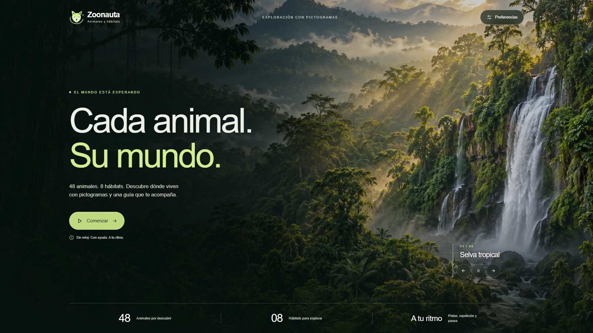

# Zoonauta 3.8.0

Juego de animales y hábitats con pictogramas y una guía de inteligencia artificial.
Disponible en español y portugués brasileño, con voces locales Piper y Kokoro
y voces compatibles de Microsoft y Google del navegador.



## Cómo se juega

Pulsa **Comenzar** y escoge **Yo elijo** o **El agente elige**.
El catálogo permite elegir cualquiera de los 48 animales, en ocho páginas de seis,
con búsqueda global por nombre. En modo agente, cada partida mezcla los 48 animales
y presenta tantos como hayas elegido en Preferencias (de 1 a 48; ocho por defecto).
No se repiten animales dentro de la partida y una nueva partida comienza con otro animal.
Pausar, repetir o recargar conserva el orden de la partida en curso.

Cada reto presenta el animal, una pregunta y ocho hábitats. Las tarjetas usan paisajes
realistas generados específicamente para ellas, con composición central, nombre y
número del **01 al 08**. Las preguntas y pistas conservan sus secuencias de pictogramas,
con texto de apoyo y lectura en voz alta. Una selección pendiente ofrece una pista
nueva automáticamente, sin castigo. **Pista** usa un foco; **Repetir** conserva el
contenido, **Pausar** suspende el reto y **Salir** permite terminarlo.
El cierre muestra los retos realmente completados y permite comenzar otra partida.
No hay puntos competitivos ni límite de tiempo o intentos.

En computadora, el animal y los controles quedan a la izquierda; la guía y los
ocho hábitats, alineados a la derecha. El tablero cabe sin scroll desde 1024 × 768
y 1280 × 720. La cabecera, el logo y Preferencias quedan en el inicio; el pie se
oculta durante el juego. En móvil, el contenido se apila sin perder opciones.

Los 95 recursos educativos activos son ilustraciones originales con transparencia:
48 animales, ocho símbolos de hábitat y 39 apoyos o controles. Cada animal tiene una
única caricatura. Los 33 apoyos de comunicación renovados en 3.8 siguen el mismo estilo
de la capibara aprobada: contornos definidos, colores naturales y sombreado suave.
Explorar y Buscar tienen representaciones distintas. Los pictogramas de preguntas,
pistas y controles se muestran sin recuadros blancos. Su comprensión CAA sigue
pendiente de evaluación con usuarios de Kallpa.

La portada conserva sus ocho paisajes y cambia de fondo cada diez segundos.
Pausar actúa al pulsarlo; play o las flechas reanudan y reinician el intervalo.
Preferencias y una pestaña inactiva suspenden temporalmente el carrusel.
La interfaz se adapta a móvil y permite selección con teclado.

## Ejecutar el juego

Clona este repositorio o descarga y extrae su ZIP. Abre la terminal en la carpeta
que contiene `codigo`, `datos`, `docs`, `assets` y `tests`. Al extraer el ZIP en
Windows, esa carpeta puede quedar dentro de otra `Zoonauta-main`. Para jugar:

En Windows abre **iniciar_juego.bat**. En Linux/macOS ejecuta
`bash iniciar_juego.sh`. También puedes iniciarlo desde una terminal:

```console
py -3 -m codigo.interfaz.iniciar
```

En Linux/macOS utiliza `python3` en lugar de `py -3`. El iniciador prepara un
entorno aislado con Python 3.12, los motores y los modelos, y abre
http://127.0.0.1:8766. Puedes conservar tu Python 3.14: el juego prepara su propia
versión compatible. Mantén la terminal abierta; Ctrl+C detiene el servidor.

La primera preparación requiere Internet y descarga unos **656 MB de modelos**,
además de Python y las dependencias que falten. Las descargas se verifican por
huella y tamaño. Si se interrumpen, vuelve a abrir el iniciador: conserva los
archivos completos comprobados. Después puedes jugar y escuchar las voces locales sin
conexión, claves de API ni cuentas adicionales.

Si la preparación falla por la conexión o por restricciones del equipo, el juego
abre con los recursos disponibles. Para omitir todas las instalaciones y descargas,
abre **iniciar_sin_descargas.bat** en Windows, o ejecuta:

```console
py -3 -m codigo.interfaz.iniciar --sin-descargas
```

En Linux/macOS usa `python3`. Puedes elegir en Preferencias las voces locales ya
completas o las voces compatibles del navegador. Si no hay ninguna disponible,
puedes jugar con texto y pictogramas. Esta opción requiere Python, pero no los
paquetes de voz. Para preparar las voces más adelante, abre `iniciar_juego.bat`
con una conexión que permita las descargas. `--solo-preparar` sigue indicando un
error si no logra completar la instalación.

Para usar otro puerto:

```console
iniciar_juego.bat --puerto 8767
```

Para actualizar una copia descargada como ZIP, detén el servidor, descarga el ZIP
actual y extrae la nueva versión. Puedes copiar la carpeta `modelos_voz` de la
versión anterior para evitar descargarla otra vez; el iniciador la comprobará.
Un ZIP anterior no se actualiza automáticamente.

Antes de comenzar, abre **Preferencias → Idioma** en la portada para elegir Español o Português (Brasil). Cambian
los controles, los 48 nombres de animales, los ocho hábitats, las etiquetas de
pictogramas, las pistas, las confirmaciones y las voces. El selector conserva siete opciones
locales por idioma y añade las voces compatibles de Microsoft y Google del navegador,
agrupadas por proveedor; **Probar voz** reproduce una muestra. La selección
manual se conserva por idioma mientras la página está abierta. Las voces del navegador
no necesitan descargar modelos ni claves de API; algunas requieren Internet.
Se aceptan las regiones latinoamericanas del español (incluidos es-419 y es-US)
y pt-BR. No se presenta una voz es-ES como latinoamericana ni pt-PT como brasileña.
Su disponibilidad depende del navegador y de las voces instaladas.

| Idioma | Motor | Opciones |
|---|---|---|
| Español | Piper | Claude (México), Ald (México, media y ligera), Daniela (Argentina) |
| Español | Kokoro | Dora, Alex, Santa |
| Português (Brasil) | Piper | Cadu, Edresson, Faber, Jeff |
| Português (Brasil) | Kokoro | Dora, Alex, Santa |
| Español latinoamericano | Microsoft / Google | Las voces regionales que expone el navegador |
| Português (Brasil) | Microsoft / Google | Las voces pt-BR que expone el navegador |

Ald ofrece dos variantes del mismo hablante. El ZIP contiene el catálogo y el
instalador; los pesos grandes se descargan al preparar el juego. Consulta
[la guía de voces](docs/interfaz/alternativas_voz.md) y
[la guía de interfaz](docs/guia_interfaz.md).

## Inteligencia artificial y revisión

La interfaz carga el modelo sintético contextual R01, congelado, elegido como primera
réplica y no por su rendimiento. El núcleo comparte las asociaciones y transiciones
con consola y simulador. Las interacciones manuales se registran sin modificar los
parámetros del modelo. La selección aleatoria del animal es independiente de la
política que escoge las pistas. Consola y simulador conservan su orden reproducible.

Para revisar y exportar los registros de la sesión, abre
http://127.0.0.1:8766/revision en el mismo navegador.

Otros comandos desde esta carpeta, que contiene codigo, datos, docs, assets y tests:

```console
python -m codigo.poc.consola --modalidad JUGADOR --retos 2
python -m codigo.interfaz.servidor --politica ID3 --puerto 8001
python -m codigo.interfaz.servidor --politica ROTACION --puerto 8002
python -m codigo.poc.consola --modalidad AGENTE --retos 2
python -m codigo.entrenamiento.experimento --salida resultados_nuevos
python -m codigo.poc.aceptacion
python -m unittest discover -s tests -v
```

ID3 construye el árbol calculando ganancias. El aprendizaje probabilístico y su
evaluación separada se realizaron con datos sintéticos: 34 560 retos de entrenamiento
y 51 840 de evaluación. Los resultados se conservan en `docs/experimentos`.
La ayuda automática ante selecciones pendientes está activa en la interfaz;
consola y simulador conservan su protocolo de ayuda explícita.

La versión 3.8 pasó 70 pruebas Python, ocho casos de aceptación de consola y
21 casos de navegador (17 de interfaz y cuatro de voces controladas). Comprueban
transiciones, repetición, pausa, duplicados, traducciones, transparencia y recorridos
completos del agente sin repetir los 48 animales. [Revisión](docs/interfaz/3.8/revision.json).
Las evidencias anteriores de síntesis real de las 14 voces permanecen en
`docs/interfaz/revision_voces_locales.json`; no certifican pronunciación o escucha
en otros dispositivos. Los documentos V1/V2 y sus resultados son antecedentes.

## Imágenes y documentación

Las ilustraciones y paisajes son imágenes sintéticas generadas con la herramienta
integrada de imágenes, no fotografías de ejemplares o lugares específicos.
Las rutas, prompts, transparencia y huellas de integridad se documentan en:

- [Animales](datos/imagenes_animales_ia.json).
- [Persona y agente](datos/imagenes_modalidad_ia.json).
- [Símbolos de hábitat y controles](datos/imagenes_habitats_controles_ia.json).
- [Apoyos de preguntas y pistas, versión 3.8](datos/imagenes_apoyos_ia.json).
- [Paisajes centrados de las tarjetas](datos/imagenes_paisajes_tarjetas_ia.json).

Los 17 WebP decorativos utilizados (ocho fondos de inicio, un atlas y ocho paisajes
de tarjetas) son adicionales al banco de 95 pictogramas.
Los créditos de ARASAAC y de los SVG del prototipo se mantienen como antecedentes;
esos recursos no son las imágenes activas. Las ilustraciones originales se ofrecen
bajo CC BY-NC-SA 4.0. Consulta [créditos](docs/creditos_pictogramas.md),
[guía de interfaz](docs/guia_interfaz.md) y [diseño visual](docs/interfaz/diseno_visual.md).
