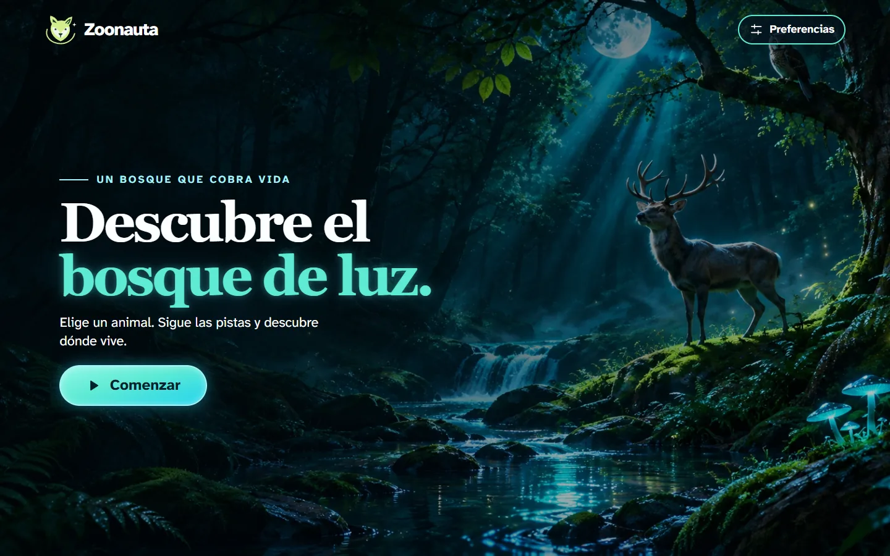

# Zoonauta 6.0.0

Juego de animales y hábitats con pictogramas y una guía de inteligencia artificial.
Disponible en español y portugués brasileño. La guía habla con la voz grabada de
Zoonauta (Marcela, ElevenLabs) en español; en portugués se juega con texto y
pictogramas, sin voz por ahora.



La 6.0 es la versión principal desde el 14 de noviembre de 2026. Conserva las reglas,
los 288 animales, los 48 hábitats, las pistas y los dos modos de la 5.0; cambia la
interfaz (React + TypeScript + Vite, servida por el mismo servidor Python) y la voz.
La 5.0 sigue disponible en `/v5/` con su aspecto y sus voces.

## Cómo se juega

La portada «Bosque de luz» explica el juego en una frase: *Elige un animal. Sigue las
pistas y descubre dónde vive.* Pulsa **Comenzar** y escoge **Yo elijo** o
**El agente elige**. La guía lee «¿Quién elige el animal?» al abrir ese diálogo.

- **Yo elijo:** el catálogo muestra los 288 animales, con búsqueda por nombre y
  páginas de seis. En escritorio, la columna izquierda reúne título, progreso,
  búsqueda, páginas, Pausar y Salir.
- **El agente elige:** cada partida mezcla los 288 animales, sin repetir, y presenta
  tantos como hayas elegido en Preferencias (de 1 a 48; ocho por defecto).

Cada reto presenta el animal grande a la izquierda con **Pista**, **Repetir**,
**Pausar** y **Salir** debajo; a la derecha, la guía con su frase y sus pictogramas, y
los hábitats para elegir (2, 4 u 8, según Preferencias). Al pedir **Pista**, o tras
elegir un hábitat no confirmado, el **agente de la guía** elige la ayuda que mejor
distingue las opciones que quedan en pantalla, sin castigo ni límite de tiempo
(ver [El agente de la 6.0](#el-agente-de-la-60)).
Al acertar, el hábitat elegido se marca con ✓ y **Continuar** pasa al siguiente reto.
Pausar muestra al robot sentado en su banco; al terminar, el robot se despide y
**Comenzar otra partida** vuelve a la portada. No hay puntos, límite de tiempo ni de
intentos.

Las opciones de hábitat salen de una lista de afinidad por animal: primero el
principal, luego los secundarios documentados y después hábitats afines por medio,
salinidad, clima, altitud y vegetación. Cualquier secundario documentado que se
muestre también completa el reto. Las opciones no cambian al pedir pistas, repetir,
pausar o recargar.

### Pantalla completa, sin desplazamiento

Cada pantalla ocupa exactamente la ventana en escritorio (1440 × 900), portátil
(1280 × 720) y móvil (390 × 844): no hay que subir ni bajar. En ventanas muy bajas
(zoom del 200 %, móvil apaisado o de 360 × 640) la página se desplaza como último
recurso, sin aplastar tarjetas, imágenes ni controles.

### Identidad visual

Azul noche con acento cian, titulares en serif y el fondo aprobado «Bosque de luz» en
la portada (sin pictogramas en ella). Los pictogramas del juego van sin fondo. El
movimiento es breve y opcional: **Reducir movimiento** en Preferencias o la
preferencia del sistema lo desactivan.

## Preferencias y voz

**Preferencias** («Tu expedición · A tu manera.») se abre encima de cualquier pantalla:

- **Idioma:** Español o Português (Brasil).
- **La partida:** cuántos animales explorar (1 a 48, con − y +) y hábitats para elegir
  (2, 4 u 8). Se aplican al comenzar.
- **Voz:** *Una guía con voz*, la voz (**Marcela · ElevenLabs**), el ritmo de lectura
  y **Probar voz**, que reproduce el mensaje que está en pantalla.
- **Pantalla:** *Reducir movimiento*.
- **Créditos visuales** con la versión del programa y **Volver al juego**.

Se cierra con Volver al juego, la ×, Escape o tocando fuera.

La voz de la guía son 350 grabaciones completas en español latinoamericano
(`assets/voz/grabada/es-419`), una por mensaje: cubren los 353 mensajes del juego
(tres comparten texto). Nunca se unen fragmentos y suena una sola voz a la vez.
Funcionan sin Internet y sin descargar modelos. En portugués la voz está bloqueada
hasta que existan grabaciones. La prueba `tests.test_voz_grabada_cobertura` juega
todos los animales y comprueba que cada mensaje tenga su grabación.

Las voces locales Piper y Kokoro se retiraron del proyecto el 14 de noviembre de 2026. La 5.0
(`/v5/`) usa la misma voz grabada y, si falta, las voces compatibles del navegador.

## Cierre técnico e instrucciones de uso

El [manual de usuario](docs/manual_usuario.md) explica el inicio y los controles.
El [contrato de identidad 6.0](docs/interfaz/6.0/identidad.md) recoge las decisiones de
diseño, y [accesibilidad y rendimiento](docs/interfaz/6.0/accesibilidad_rendimiento.md)
las mediciones de Lighthouse. El [cierre técnico del Hito 3](docs/cierre_tecnico_hito3.md)
reúne ejecución, casos de borde y límites de la versión 5.0. El informe, el video y la
evaluación con usuarios son entregables distintos de estas verificaciones.

## Ejecutar el juego

Clona este repositorio o descarga y extrae su ZIP. Abre la terminal en la carpeta
que contiene `codigo`, `datos`, `docs`, `assets` y `tests`. Al extraer el ZIP en
Windows, esa carpeta puede quedar dentro de otra `Zoonauta-main`. Para jugar:

En Windows abre **iniciar_juego.bat**. En Linux/macOS ejecuta
`bash iniciar_juego.sh`. También puedes iniciarlo desde una terminal:

```console
py -3 -m codigo.interfaz.iniciar
```

En Linux/macOS utiliza `python3` en lugar de `py -3`. El iniciador abre
http://127.0.0.1:8766, que es **Zoonauta 6.0**. La versión 5.0 sigue en
http://127.0.0.1:8766/v5/. Mantén la terminal abierta; Ctrl+C detiene el servidor.

No se descarga ni se instala nada: la voz de la guía (las grabaciones de Zoonauta) viene
en el repositorio y el servidor solo usa la biblioteca estándar de Python. Basta con
tener Python 3.10 o posterior.

Para usar otro puerto:

```console
iniciar_juego.bat --puerto 8767
```

Para actualizar una copia descargada como ZIP, detén el servidor, descarga el ZIP
actual y extrae la nueva versión.

**Idioma:** en Preferencias puedes elegir Español o Português (Brasil). Cambian los
controles, los nombres de animales y hábitats, las etiquetas de pictogramas, las
pistas y las confirmaciones. No se sustituye es-419 por es-ES ni pt-BR por pt-PT. La
voz solo está en español por ahora.

La 5.0 (`/v5/`) conserva las voces compatibles del navegador. Sus antiguas voces locales Piper
y Kokoro se retiraron; su historia está en [la guía de voces](docs/interfaz/alternativas_voz.md)
y [la guía de interfaz](docs/guia_interfaz.md).

## Inteligencia artificial y revisión

### El agente de la 6.0

En la partida principal (288 animales, 48 hábitats) un agente local decide qué ayuda
dar en cada momento: no usa Internet ni una API externa. Considera el animal, los
hábitats visibles, lo que ya se eligió, las ayudas ya mostradas y si se pulsó
**Repetir**. Puede decir las tres pistas revisadas del hábitat (la 3, «Señala el
hábitat…», es el apoyo explícito) y 32 ayudas breves por rasgo («Busca un lugar
frío.»), que solo usa cuando existe su grabación. Solo afirma rasgos que una pista
revisada ya dice; lo que no está documentado se trata como desconocido, nunca como
falso, y un hábitat no confirmado no se presenta como incorrecto. Tras elegir un
hábitat parecido, no repite algo que también lo describa. Es un modelo de decisión con
reglas y una utilidad de parámetros fijos: no aprende durante la partida.

Junto a él hay una línea base ID3 (ganancia de información sobre las opciones
visibles) y la secuencia editorial anterior, que se pueden comparar con
`--agente ID3_OPCIONES` o `--agente PISTAS_PROGRESIVAS`. Cómo funciona, cómo se
evalúa, los resultados (estructurales y con un jugador sintético, no con personas) y
lo que falta revisar están en [docs/agente/agente_6.md](docs/agente/agente_6.md).

Los secundarios documentados y los contrastes preferentes se guardan en
[`datos/expedicion/animales.json`](datos/expedicion/animales.json); los rasgos de los
hábitats, en [`datos/expedicion/atributos_habitats.json`](datos/expedicion/atributos_habitats.json).
El conjunto de asociaciones secundarias todavía admite ampliaciones con respaldo.

### Catálogo original (48 animales, ocho hábitats)

Con `--catalogo-original`, la interfaz carga el modelo sintético contextual R01 de
`docs/experimentos/hito2/entrenamiento/modelos`, congelado, elegido como primera
réplica y no por su rendimiento. El núcleo comparte las asociaciones y transiciones
con consola y simulador. Las interacciones manuales se registran sin modificar los
parámetros del modelo. La selección aleatoria del animal es independiente de la
política que escoge las pistas. Consola y simulador conservan su orden reproducible.

En ese catálogo original, el agente probabilístico utiliza el historial del reto: tras una selección pendiente,
prioriza un atributo que distinga el paisaje elegido del hábitat guía. Tras dos
selecciones pendientes ofrece el apoyo explícito. **Repetir** conserva exactamente
el mensaje; si después se solicita otra pista, puede reformularlo una vez antes de
avanzar. En cada nivel prioriza variantes todavía no presentadas en ese reto y evita
la repetición inmediata cuando hay alternativas. Estas reglas son observables en
`/revision`; complementan el selector entrenado y no suponen aprendizaje en vivo.

Para revisar y exportar los registros de la sesión, abre
http://127.0.0.1:8766/revision en el mismo navegador.

Otros comandos desde esta carpeta, que contiene codigo, datos, docs, assets y tests:

```console
python -m codigo.poc.consola --modalidad JUGADOR --retos 2
python -m codigo.interfaz.servidor --agente ID3_OPCIONES --puerto 8003
python -m codigo.entrenamiento.evaluar_agente6 --salida resultados_nuevos/agente6
python -m codigo.interfaz.servidor --catalogo-original --politica ID3 --puerto 8001
python -m codigo.interfaz.servidor --catalogo-original --politica ROTACION --puerto 8002
python -m codigo.poc.consola --modalidad AGENTE --retos 2
python -m codigo.entrenamiento.experimento --salida resultados_nuevos
python -m codigo.entrenamiento.evaluar_demo --entrenamiento 15360 --salida resultados_nuevos/demo
python -m codigo.nucleo.auditoria --salida resultados_nuevos/auditoria.json
python -m codigo.nucleo.verificar_paquete
python -m codigo.poc.aceptacion
python -m unittest discover -s tests -v
```

ID3 construye el árbol calculando ganancias. La evaluación del protocolo actual
utilizó datos sintéticos: **276 480 retos de entrenamiento y 155 520 de evaluación**,
con tres condiciones, seis réplicas y las políticas ID3, rotación y probabilística,
separadas por tamaño del panel. Las semillas de entrenamiento y evaluación son
distintas; los parámetros permanecen congelados al evaluar.
Los resultados y las curvas de evolución se conservan en
[evaluacion_demo.json](docs/experimentos/hito2/evaluacion_demo.json).
El entrenamiento ampliado utiliza 15 360 retos por condición y réplica, frente a
los 1 920 iniciales. Conserva las semillas, el prefijo del entrenamiento y la
separación de la evaluación. El error medio frente a las probabilidades artificiales
pasó de 0,104 a 0,053. Todas las distribuciones tienen observaciones; 81 de las
2 592 distribuciones de las 18 réplicas siguen teniendo menos de diez etiquetas.
Las tres últimas variaciones medias son inferiores a 0,01 en cada réplica. Este
diagnóstico de estabilidad media no prueba convergencia general ni precisión de
cada variante. La primera réplica contextual sigue fijada como modelo del demo;
no se eligió una semilla por sus resultados de evaluación.
El [diagnóstico](docs/experimentos/hito2/diagnostico_entrenamiento.json) conserva
la comparación y sus límites. Para reproducirlo:

```console
python -m codigo.entrenamiento.diagnosticar --antes docs/experimentos/hito2/antecedentes_1920 --despues docs/experimentos/hito2 --salida resultados_nuevos/diagnostico.json
```

El simulador no modela el efecto cognitivo del número de opciones: resultados iguales
entre tamaños comprueban el flujo, no que los tres tamaños sean igual de accesibles.
Las ejecuciones anteriores de `docs/experimentos` son antecedentes.

La ayuda automática ante selecciones pendientes está activa en la interfaz y en
`evaluar_demo`. El comando histórico `experimento` usa ayuda explícita salvo que se
indique `--ayuda-automatica`; admite `--opciones 2`, `4` u `8`. La consola también
admite `--opciones`. Las 315 relaciones pendientes conservan su estado y no se
consideran errores. La auditoría comprueba referencias registradas, secuencias y
traducciones; no sustituye la revisión biológica ni la validación con usuarios.

La verificación del manifiesto acepta exclusivamente la conversión LF → CRLF de
los iniciadores BAT declarada en `.gitattributes`; comprueba el resto de su contenido
y todos los demás archivos por tamaño y SHA-256. Una copia recién extraída puede
probarse sin instalar voces ni reutilizar el entorno local:

```console
python -m tests.verificar_copia_limpia --carpeta ruta_de_la_copia_extraida --salida resultados_nuevos/copia_limpia
```

La prueba ejecuta el iniciador real, suprime únicamente la apertura de una ventana y
comprueba partidas completas en ambas modalidades con 2, 4 y 8 opciones. Requiere Python
y una carpeta sin `.venv-voz` ni `modelos_voz`.

**Zoonauta 6.0 (2026-11-14):** pasan **109 pruebas Python** (incluidas las 14 del agente
y la cobertura de la voz grabada jugando todos los animales con el agente) y las pruebas de
navegador de la 6.0: portada (6 casos
con axe), recorrido (9), cuatro partidas completas con teclado sin desplazamiento (2, 4 y 8
hábitats, español, portugués y 320 px) y voz (9). `python -m tests.comparar_versiones`
compara la 5.0 y la 6.0 en seis tamaños de pantalla y mide desplazamiento y tarjetas aplastadas.

Historial de la 5.0: la revisión local pasó **96 pruebas Python**, los ocho casos de aceptación de
consola y **63 casos de navegador**: 20 de revisión general, seis del modo 2/4/8
en ambos idiomas, cinco de voces controladas, 16 de Preferencias y teclado y
16 del catálogo adaptable, incluidos ambos idiomas y conservación del foco.
Las [evidencias del cierre](docs/experimentos/hito3/revision_cierre.json) conservan
el alcance técnico y los pasos que requieren evaluación humana.
El comprobador general libera los
contextos entre escenarios conservando la cookie de la partida; mantiene todas
las comprobaciones. Comprueba transiciones, repetición, pausa, duplicados,
traducciones, transparencia, cierre, teclado, móvil, progreso real y los 48 animales
sin repeticiones. [Revisión del agente](docs/experimentos/hito2/revision_codigo.json).
La copia pública descargada también completó seis partidas sin instalar voces.
Las evidencias anteriores de síntesis real de las 14 voces permanecen en
`docs/interfaz/revision_voces_locales.json`; no certifican pronunciación o escucha
en otros dispositivos. Los documentos V1/V2 y sus resultados son antecedentes.

## Imágenes y documentación

Las ilustraciones y paisajes son imágenes sintéticas generadas con la herramienta
integrada de imágenes, no fotografías de ejemplares o lugares específicos.
Las rutas, prompts, transparencia y huellas de integridad se documentan en:

- [Animales](datos/imagenes_animales_ia.json).
- [Persona y agente](datos/imagenes_modalidad_ia.json).
- [Robot de despedida y pausa](datos/imagenes_cierre_pausa_ia.json).
- [Símbolos de hábitat y controles](datos/imagenes_habitats_controles_ia.json).
- [Apoyos de preguntas y pistas, versión 3.8](datos/imagenes_apoyos_ia.json).
- [Paisajes centrados de las tarjetas](datos/imagenes_paisajes_tarjetas_ia.json).

La portada de la 6.0 usa el fondo «Bosque de luz» ([original](assets/portada/bosque-de-luz-ciervo.png)).
La 5.0 usa [48 fondos panorámicos de portada](codigo/interfaz/web/fondos/catalogo). Las dos
versiones comparten los 48 paisajes centrados de las tarjetas, los pictogramas y el robot.
Los créditos de ARASAAC y de los SVG del prototipo se mantienen como antecedentes;
esos recursos no son las imágenes activas. Las ilustraciones originales se ofrecen
bajo CC BY-NC-SA 4.0. Consulta [créditos](docs/creditos_pictogramas.md),
[guía de interfaz](docs/guia_interfaz.md) y [diseño visual](docs/interfaz/diseno_visual.md).
