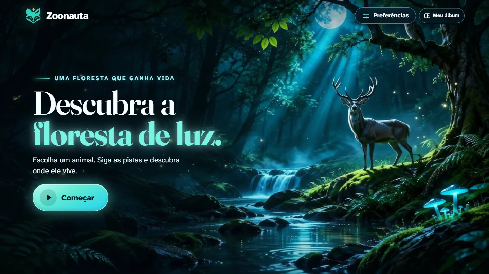
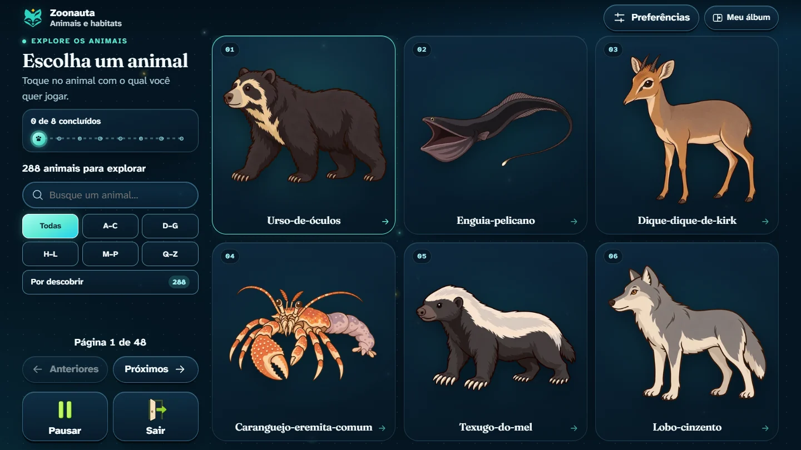
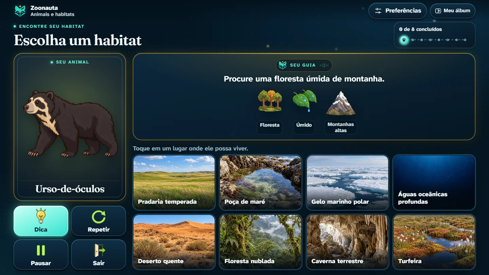
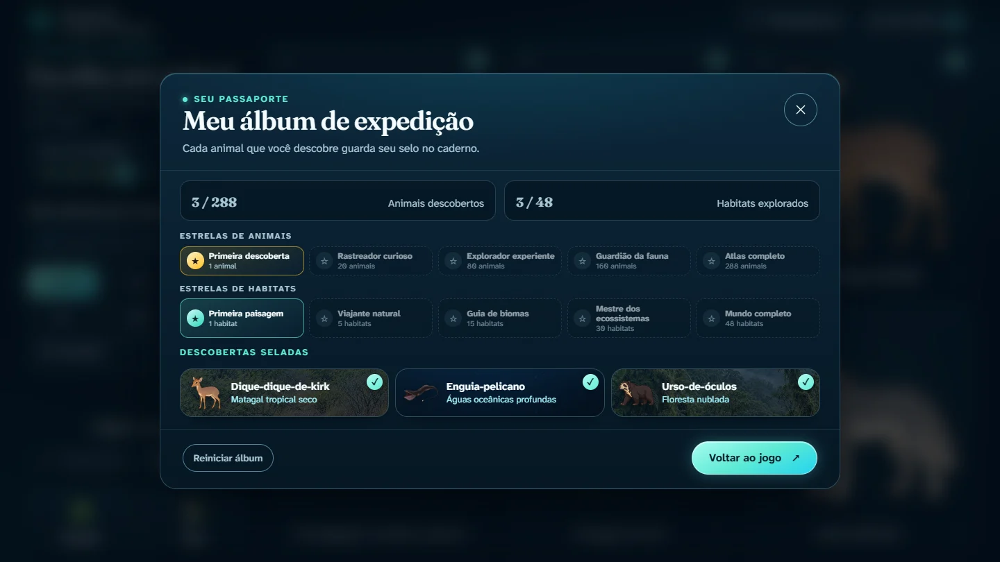
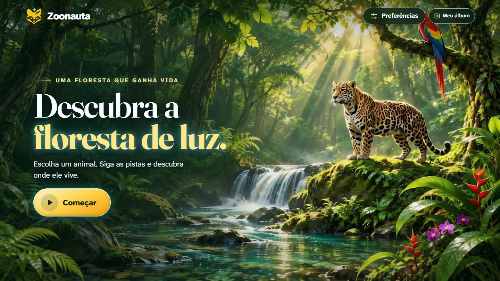
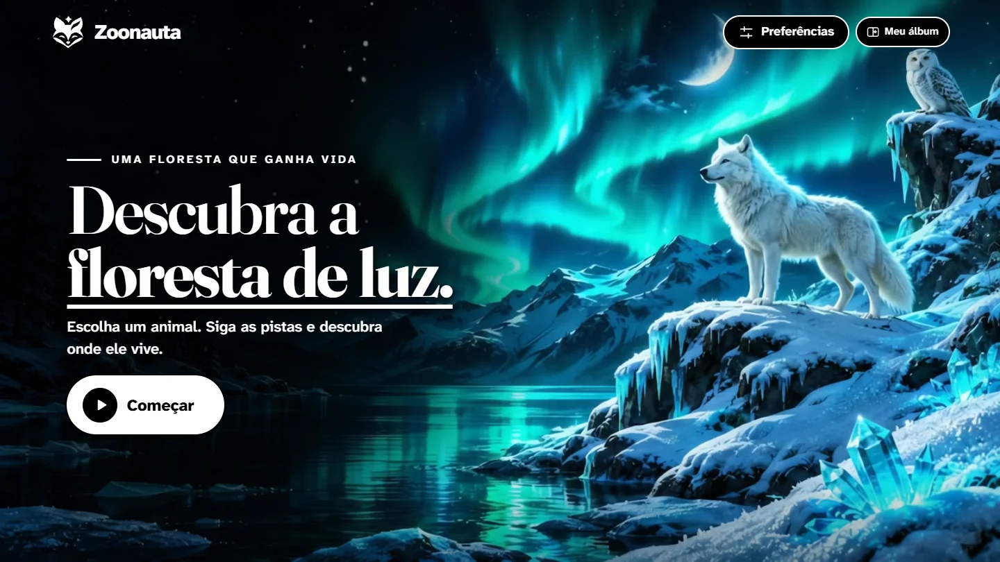

<div align="center">

<picture>
  <source media="(prefers-color-scheme: dark)" srcset="docs/interfaz/readme/logo-dark.svg" />
  <source media="(prefers-color-scheme: light)" srcset="docs/interfaz/readme/logo-light.svg" />
  
</picture>

<br />

**Escolha um animal. Siga as pistas e descubra onde ele vive.**

Jogo educativo de animais e habitats com pictogramas CAA, guia adaptativo local e 8 vozes gravadas completas.

<p>
  <a href="https://matarojo.pythonanywhere.com/"><strong>Jogar agora</strong></a>
  &nbsp;&middot;&nbsp;
  <a href="#galeria">Galeria</a>
  &nbsp;&middot;&nbsp;
  <a href="#como-jogar">Como jogar</a>
  &nbsp;&middot;&nbsp;
  <a href="#idiomas-e-vozes">Idiomas e vozes</a>
  &nbsp;&middot;&nbsp;
  <a href="#executar-o-jogo">Executar</a>
</p>

<p>
  
  
  
  
  
  
</p>

<p>
  <a href="README.md">Español</a> &nbsp;|&nbsp; <strong>Português (Brasil)</strong> &nbsp;|&nbsp; <a href="README.en.md">English</a>
</p>

</div>

---

<p align="center">
  
</p>

## Galeria

<table>
  <tr>
    <td width="50%">
      
      <p align="center"><strong>Catálogo de 288 animais</strong><br />Ordem variada por biomas, filtros alfabéticos, busca e filtro <em>Por descobrir</em>.</p>
    </td>
    <td width="50%">
      
      <p align="center"><strong>Pistas adaptativas com pictogramas CAA</strong><br />O agente escolhe a dica mais útil conforme as opções visíveis, sem relógio nem punições.</p>
    </td>
  </tr>
  <tr>
    <td colspan="2">
      <p align="center">
        
      </p>
      <p align="center"><strong>Meu álbum de expedição</strong><br />Passaporte pessoal salvo no navegador com 2 fileiras de 5 estrelas (animais e habitats) e coleção paginada 3 × 3.</p>
    </td>
  </tr>
</table>

### Três temas visuais adaptativos

<table>
  <tr>
    <td width="33.3%" align="center">
      
      <br /><strong>Floresta à noite</strong><br /><sub>Observatório bioluminescente (padrão)</sub>
    </td>
    <td width="33.3%" align="center">
      
      <br /><strong>Floresta de dia</strong><br /><sub>Tema claro editorial com paleta solar</sub>
    </td>
    <td width="33.3%" align="center">
      
      <br /><strong>Alto contraste</strong><br /><sub>WCAG AAA 21:1 em preto e branco puro</sub>
    </td>
  </tr>
</table>

---

## Como jogar

Toque em **Começar** e escolha quem seleciona o animal:

- **Eu escolho:** explore os **288 animais** em páginas de 6. Em *Todas* e *Por descobrir*, os biomas aparecem intercalados em ordem aleatória a cada partida; nos filtros `A–C` a `Q–Z` e na busca, ficam em ordem alfabética. Animais já descobertos exibem o selo `✓`.
- **O agente escolhe:** prioriza automaticamente animais ainda não descobertos no seu álbum e, ao completar todos os 288, embaralha novamente todo o catálogo de forma contínua. Configure de **1 a 48 desafios** por partida.

Em cada desafio, o animal aparece à esquerda com **Pista**, **Repetir**, **Pausar** e **Sair**; à direita, o guia com frase de apoio + pictogramas CAA e **2, 4 ou 8 habitats** para escolher. Ao acertar, o habitat recebe o selo `✓`, entra para **Meu álbum** e toca uma celebração sonora do bioma.

---

## Idiomas e vozes

O Zoonauta traduz ao vivo toda a interface, os **288 animais**, os **48 habitats**, os rótulos CAA, as pistas, as confirmações e o álbum. Inclui **8 vozes gravadas completas** (`412` mensagens por voz · `3 296` áudios ao todo) que funcionam offline, sem APIs externas:

| Idioma | Vozes disponíveis | Áudios por voz |
| :--- | :--- | :---: |
| **Español (`es-419`)** | Marcela, Valeria, Gaby, Diego | 412 |
| **Português (`pt-BR`)** | Roberta, Will | 412 |
| **English (`en`)** | Jessica, Mark | 412 |

O servidor suporta nativamente **AAC (`.m4a` / `audio/mp4`)** — usado a 32 kbps mono em `Zoonauta-Web.zip` —, **MP3** e **WAV**.

---

## Acessibilidade e preferências

- **Tamanho do texto:** *Pequeno*, *Normal* e *Grande*.
- **Reduzir movimento:** respeita `prefers-reduced-motion` e substitui vídeos e animações por cenas estáticas nítidas.
- **Proteger Preferências:** bloqueio opcional por toque prolongado para evitar alterações acidentais.
- **Sons da floresta e háptica:** paisagem sonora suave, 5 famílias acústicas por bioma (mar, água doce, floresta, montanha e savana), música calma em pausa e fanfarra de vitória; o volume reduz automaticamente quando o guia fala.
- **PWA instalável:** inclui manifesto web e *service worker* (*Instalar app* nas Preferências).

---

## Executar o jogo

### No seu computador (Windows / Linux / macOS)

Requer apenas **Python 3.10 ou superior** (o servidor usa somente a biblioteca padrão do Python):

```console
# Windows
iniciar_juego.bat
# ou pelo terminal:
py -3 -m codigo.interfaz.iniciar

# Linux / macOS
python3 -m codigo.interfaz.iniciar
```

O jogo abre em `http://127.0.0.1:8766` e o painel técnico em `/revision`. Para outra porta:

```console
py -3 -m codigo.interfaz.servidor --puerto 8080
```

### Publicação na web (Hostinger / WSGI / Docker)

- **Pacote web pronto para upload:** baixe **`Zoonauta-Web.zip`** (~71 MB) na aba [Releases](https://github.com/Matador-Rojo/Zoonauta/releases). Traz o frontend compilado, imagens otimizadas e as 8 vozes completas em AAC 32 kbps (`.m4a`).
- **WSGI sem dependências:** `codigo.interfaz.wsgi:application` (compatível com Hostinger, Gunicorn e PythonAnywhere).
- **Docker:** `Dockerfile` e `docker-compose.yml` inclusos na raiz.

---

## Estrutura e testes

- `codigo/motores/` e `codigo/entrenamiento/`: agente adaptativo local, baseline `ID3`, seletor probabilístico Beta-Bernoulli e simulador.
- `codigo/nucleo/`, `codigo/respuestas/` e `codigo/interfaz/`: regras da partida, gerador CAA, servidor HTTP/WSGI e frontend compilado (`web6/`).
- `frontend/`: aplicação React 19 + TypeScript + Vite.
- `datos/` e `assets/`: catálogo validado, traduções (`pt-BR`, `en`), manifesto SHA-256, ilustrações, pictogramas, vozes e fundos.
- `docs/` e `tests/`: documentação técnica, experimentos reprodutíveis e testes automatizados.

```console
python -m unittest discover -s tests -v
python -m codigo.nucleo.verificar_paquete
npm --prefix frontend run check
```

## Créditos

Ilustrações de animais, pictogramas de apoio e paisagens originais gerados com IA sob licença **CC BY-NC-SA 4.0**. Mais detalhes em [docs/creditos_pictogramas.md](docs/creditos_pictogramas.md) e [docs/manual_usuario.md](docs/manual_usuario.md).
