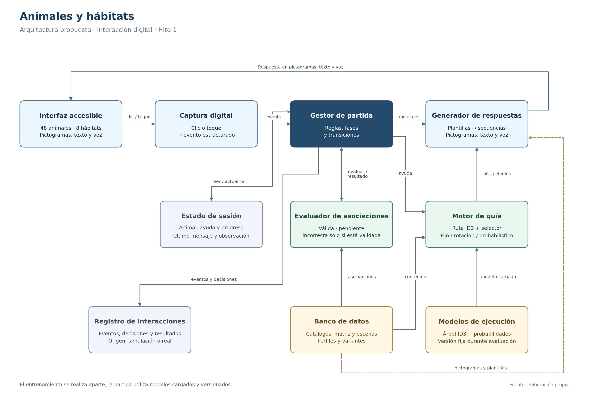
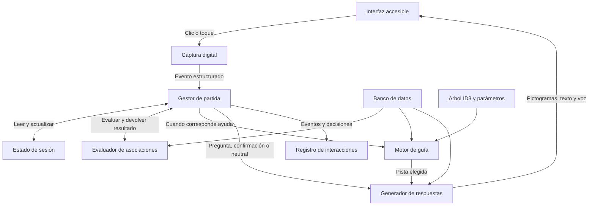

# Animales y hábitats: arquitectura del sistema

Versión 1 · 9 de octubre de 2026 · Diseño para el Trabajo Parcial

## 1. Propósito y enfoque

La arquitectura conecta la captura digital de pictogramas, el motor de decisión y la generación de respuestas accesibles. El jugador interactúa mediante clics o toques. El sistema interpreta la acción, consulta el estado del reto y produce una pregunta, pista, confirmación o respuesta neutral.

Se propone un núcleo común de juego que puedan utilizar tanto una simulación en consola como la interfaz digital. Las reglas y las decisiones se implementarán una sola vez. Así, una misma selección tendrá el mismo resultado en el notebook y en la aplicación.

El diseño conserva el catálogo de 48 animales, las ocho categorías de hábitat y ambas modalidades de inicio. La cantidad N de retos de una partida se mantiene configurable, con 1 ≤ N ≤ 48.

La arquitectura distingue tres responsabilidades: evaluar una asociación, controlar la partida y elegir una forma de ayuda. La matriz evalúa; el gestor aplica las transiciones; el motor selecciona las pistas.

## 2. Diagrama de arquitectura

**Figura. Arquitectura propuesta del sistema de interacción digital.** Fuente: elaboración propia.

Las flechas representan los principales flujos de ejecución y consulta. El banco de datos es un recurso compartido: además de las consultas destacadas en la figura, se utiliza al iniciar la sesión y al recuperar un escenario. El estado pertenece a la sesión activa; el árbol y los parámetros son recursos versionados.

La ruta de ayuda pasa por el motor de guía. Las preguntas iniciales, confirmaciones, respuestas neutrales y mensajes de cierre se construyen a partir de las reglas del gestor y las plantillas correspondientes.

El registro recibe eventos, decisiones y resultados. El entrenamiento que produzca nuevos parámetros se ejecutará aparte y no forma parte del recorrido de cada clic durante la evaluación.

## 3. Componentes y responsabilidades

| Componente | Qué recibe | Qué realiza | Qué entrega |
|---|---|---|---|
| Interfaz accesible | Estado visible y respuesta preparada. | Presentar animales, hábitats, secuencias de pictogramas y controles. Recoger clics o toques. | Acciones del jugador. |
| Captura digital | Acción sobre un control o pictograma. | Convertir la entrada en un evento con tipo e identificadores del catálogo. | Evento estructurado. |
| Gestor de partida | Evento, estado actual y configuración. | Verificar la fase, coordinar la evaluación, aplicar transiciones y preparar la salida. | Estado siguiente, respuesta y datos de registro. |
| Evaluador de asociaciones | Animal x y hábitat h. | Consultar C(x,h) en la base de conocimiento. | VALIDA, INCORRECTA validada o PENDIENTE, con su contexto. |
| Motor de guía | Animal, hábitat de guía, nivel siguiente e historial requerido. | Recorrer ID3 y seleccionar una variante según la política configurada. | Atributo, nivel, variante y referencia de contenido. |
| Generador de respuestas | Decisión o mensaje solicitado y recursos de contenido. | Construir una secuencia ordenada de pictogramas, texto de apoyo y contenido de voz. | Respuesta lista para presentar. |
| Estado de sesión | Datos de la partida y última transición aceptada. | Conservar el reto, el progreso y los datos auxiliares entre interacciones. | Situación actual recuperable durante la sesión. |
| Banco de datos | Recursos preconfigurados y verificados. | Proporcionar catálogo, asociaciones, escenarios, perfiles, plantillas y pictogramas. | Datos necesarios para evaluar y presentar. |
| Modelos de ejecución | Árbol y parámetros preparados previamente. | Proporcionar una versión fija para las decisiones de una evaluación. | Configuración del motor y probabilidades. |
| Registro de interacciones | Eventos y decisiones producidos por el gestor. | Guardar lo presentado y el cierre de las observaciones, identificando su procedencia. | Registros para inspección, entrenamiento y comparación. |

### Interfaz accesible

En la modalidad JUGADOR, el panel desplazable permite elegir cualquiera de los 48 animales. Al presentar el reto, se muestran las ocho opciones de hábitat junto con los controles Ayuda, Repetir, Pausar y Salir.

Cuando se resuelve el reto aparece Continuar. Los controles disponibles dependen de la fase; una selección después de RETO_RESUELTO no vuelve a completar el mismo reto.

Las consultas y ayudas se presentan principalmente mediante pictogramas grandes, contraste suficiente y retroalimentación auditiva. El texto acompaña la secuencia. Las decisiones internas, estimaciones y nombres de modelos se reservan para la revisión técnica de la PoC.

### Captura digital

La captura utiliza identificadores estables. Seleccionar el pictograma de sabana se traduce en un evento SELECCIONAR_HABITAT con habitat_id = H02; no requiere interpretar una fotografía.

La captura comprueba que el identificador pertenece al catálogo. El gestor comprueba después si esa acción está permitida en la fase actual.

### Gestor de partida

El gestor es el coordinador del núcleo. Solo este componente autoriza el cambio de fase, el incremento de retos completados y el avance del nivel.

Antes de resolver un evento revisa la situación actual. Si se pulsa una acción fuera de su fase, conserva el estado educativo. La entrada no produce una respuesta de corrección biológica ni altera el progreso.

### Evaluador de asociaciones

El evaluador usa la matriz, no la hoja del árbol, para decidir si una respuesta es válida. En una pregunta general acepta todas las asociaciones confirmadas del animal.

La base actual tiene 69 asociaciones válidas y 315 pendientes; I = ∅. El evaluador no convierte una celda pendiente en una asociación incorrecta.

### Motor de guía

La ruta de ID3 determina qué información corresponde al nivel de ayuda. La política de variantes decide cómo presentar esa información:

- ID3: utilizar V1 como presentación fija.
- Rotación: alternar V1, V2 y V3 sin estimar probabilidades.
- Modelo probabilístico: elegir la variante con mayor estimación entre las permitidas.

La política se configura antes de ejecutar el experimento. Es independiente de la modalidad de inicio: AGENTE o JUGADOR.

### Generador de respuestas

El generador combina contenido verificado con los pictogramas del animal, los atributos y el hábitat correspondiente. Las plantillas incluyen su secuencia visual y el texto asociado para voz.

La respuesta se valida contra los recursos disponibles antes de presentarse. Si falta una variante, se recupera una pista base verificada del mismo nivel. El contenido del banco no se sustituye por asociaciones improvisadas.

La última respuesta educativa se conserva como un objeto ya preparado, identificado por u. Repetir recupera ese mismo contenido, sin volver a seleccionar una variante.

## 4. Recorrido común de una interacción

1. El jugador pulsa un pictograma o control.
2. La captura construye el evento y comprueba sus identificadores.
3. El gestor recupera el estado y valida la acción para la fase.
4. Si se seleccionó un hábitat, consulta al evaluador.
5. Si corresponde una nueva ayuda, calcula el nivel siguiente y solicita una decisión al motor.
6. El generador prepara la respuesta con los recursos del banco.
7. El gestor conserva el estado siguiente y la respuesta; la interfaz la presenta.
8. Se registra el evento, la decisión y el contenido presentado.

Una observación de ayuda d se abre cuando la ayuda se presenta. Una decisión calculada pero no presentada no se registra como exposición a una pista.

Los eventos tendrán identificadores para distinguir acciones reales de la interfaz de su reconstrucción visual. La actualización de pantalla por sí sola no debe volver a ejecutar la última acción.

## 5. Inicio en ambas modalidades

| Paso | Modalidad AGENTE | Modalidad JUGADOR |
|---|---|---|
| 1. Inicio | Se inicia con m = AGENTE. | Se inicia con m = JUGADOR. |
| 2. Elección | Un selector recupera un escenario del banco. | La interfaz presenta los 48 animales para elegir. |
| 3. Preparación | El gestor recibe generar_reto(x). | La captura entrega elegir_animal(x) al gestor. |
| 4. Estado del reto | Se asignan x y g = ref(x); l = 0. | Se asignan x y g = ref(x); l = 0. |
| 5. Presentación | El generador prepara la pregunta inicial en pictogramas. | El generador prepara la pregunta inicial en pictogramas. |
| 6. Guía | Se entra en ESPERANDO_RESPUESTA con las ocho opciones. | Se entra en ESPERANDO_RESPUESTA con las ocho opciones. |

Para la primera PoC, el selector automático podrá seguir una lista de escenarios preconfigurada y reproducible. Esto concreta la elección de retos para la demostración; el modelo probabilístico definido hasta ahora selecciona ayudas, no animales.

Al pulsar Continuar tras un reto resuelto, el gestor vuelve a la elección correspondiente a m. Cuando c = N, presenta el cierre en lugar de preparar otro animal.

## 6. Ejemplos de recorrido

### Solicitar ayuda para la jirafa

Situación: x = A08, g = H02, l = 0 y fase ESPERANDO_RESPUESTA.

| Paso | Componente | Operación |
|---|---|---|
| 1 | Captura | Recibe AYUDA. |
| 2 | Gestor | Confirma que el reto está activo y calcula l' = 1. |
| 3 | Motor | Recupera el atributo raíz de la ruta de H02: entorno abierto y cálido. |
| 4 | Política | Selecciona V1, V2 o V3 según la política configurada y los recursos disponibles. |
| 5 | Generador | Prepara la secuencia correspondiente y el apoyo de voz. |
| 6 | Estado e interfaz | Conservan l = 1, el nodo, la variante y u; presentan la ayuda. |
| 7 | Registro | Abre la observación de la pista presentada con el contexto y su procedencia. |

La selección probabilística depende de parámetros preparados. Si no existen datos para el contexto, se aplica el criterio de empate definido; no se afirma que la decisión inicial provenga de aprendizaje con jugadores.

### Seleccionar una asociación adicional de la capibara

Situación: x = A31; la ayuda orienta hacia agua dulce, H06. El jugador selecciona selva tropical, H01.

La captura entrega la selección al gestor. El evaluador encuentra H01 entre las asociaciones confirmadas de A31 y devuelve VALIDA. El gestor pasa a RETO_RESUELTO e incrementa c una sola vez. El generador prepara una confirmación con el contexto correspondiente de la asociación.

Si existía una observación de ayuda abierta, se cierra con y = 1. Durante la evaluación congelada se registra ese resultado sin modificar los parámetros en uso.

### Seleccionar una asociación pendiente

El evaluador devuelve PENDIENTE. El gestor conserva l, n y c, cierra cualquier observación de ayuda sin etiqueta y solicita una respuesta neutral. Se mantienen las ocho opciones y la posibilidad de pedir ayuda.

Una selección válida posterior podrá completar el reto, pero no etiquetará retrospectivamente una observación ya cerrada.

### Repetir y pausar

Repetir reproduce u exactamente. En ESPERANDO_RESPUESTA establece b = 1 como señal auxiliar y conserva la observación abierta. No avanza el nivel ni contabiliza otro reto.

Pausar muestra una capa de navegación y suspende la interacción. Conserva el contenido educativo y los datos del reto. Reanudar restaura la fase previa. El audio puede detenerse durante la pausa sin modificar el objetivo ni el nivel.

## 7. Datos e intercambio entre componentes

### Banco preconfigurado

| Recurso | Contenido |
|---|---|
| Catálogo de animales | 48 identificadores, nombres y referencias a pictogramas. |
| Catálogo de hábitats | Ocho identificadores, nombres y referencias a escenas. |
| Matriz de asociaciones | Estado de cada relación, contexto y referencias que la justifican. |
| Banco de escenarios | Animal, hábitat de guía, pregunta inicial y asociaciones confirmadas. |
| Perfiles para ID3 | Los ocho perfiles categóricos usados para construir el árbol. |
| Banco de ayudas | Pistas y variantes verificadas, con su nivel, atributos y secuencia visual. |
| Árbol y probabilidades | Estructura ID3, parámetros por contexto–variante y versiones. |

Se propone utilizar JSON para los recursos estructurados y JSONL para el registro de eventos. Es una elección de implementación para la PoC; los archivos todavía deben prepararse.

### Evento de entrada

| Campo | Uso |
|---|---|
| sesion_id | Identificar la sesión activa. |
| evento_id | Identificar una acción y evitar procesarla dos veces. |
| reto_id | Vincular una acción al reto correspondiente. |
| tipo | Iniciar, elegir animal, seleccionar hábitat, ayuda, repetir, continuar, pausa, reanudar o salir. |
| payload | Modalidad, animal_id o habitat_id, según la acción. |

No todas las acciones requieren reto_id: antes de preparar el primer reto no existe uno activo. Los eventos internos de preparación se distinguen de las entradas del jugador.

### Respuesta preparada

| Campo | Uso |
|---|---|
| contenido_id | Identificar la pregunta, ayuda, confirmación, neutral o cierre. |
| tipo_respuesta | Determinar qué presentación corresponde. |
| pictogramas | Lista ordenada de identificadores visuales. |
| texto_apoyo | Texto asociado a la secuencia. |
| texto_voz | Contenido que se enviará al adaptador de voz. |
| controles_disponibles | Controles permitidos para la fase resultante. |

La vista del reto también incluye el animal activo, las ocho opciones y el progreso. Las estimaciones del motor se guardan en una traza técnica separada.

Los recursos y modelos utilizados por una partida se identifican por versión. Eso permite reconstruir qué contenido y qué parámetros dieron lugar a una decisión.

## 8. Estado activo, registros y entrenamiento

| Tipo de información | Duración y uso |
|---|---|
| Estado activo | Se conserva por sesión: m, f, x, g, l, h, r, c, fase previa, u y datos auxiliares. |
| Última respuesta preparada | Se conserva para reproducir exactamente su secuencia mediante Repetir. |
| Memoria de variantes | Se conserva en la sesión para evitar la última variante de una pareja g–l. |
| Recursos del juego | Se cargan al iniciar y se mantienen coherentes durante la partida. |
| Parámetros de evaluación | Se cargan como una versión fija; no cambian con cada clic. |
| Registro de interacciones | Se guarda para inspección, comparación y entrenamiento posterior. |

El entrenamiento usa los registros etiquetados y produce una nueva versión de parámetros. Esa versión se evalúa en simulaciones distintas de las utilizadas para entrenar. Después podrá cargarse para otro experimento.

Thompson Sampling se ejecutará en la fase de exploración del simulador definida en el modelo principal. El modo de evaluación utilizará la política y los parámetros congelados.

Los registros distinguen origen sintético y real. Un resultado pendiente, una salida o una falta de respuesta no incrementan el parámetro asociado a y = 0.

La pausa conserva el estado dentro de la misma sesión. Recuperar una partida después de cerrar o recargar el navegador requerirá un mecanismo adicional de persistencia y no se considera implementado en esta especificación.

## 9. Herramientas propuestas para el Hito 1

| Herramienta o formato | Uso propuesto |
|---|---|
| Python | Núcleo del juego, evaluador, ID3 y modelo probabilístico. |
| Jupyter Notebook o scripts | Simulación de decisiones y experimentos iniciales. |
| Streamlit | Prototipo de selección digital y presentación de respuestas. |
| JSON | Catálogo, escenarios, asociaciones, pistas y modelos exportados. |
| JSONL | Registro de eventos y observaciones. |
| Archivos de pictogramas | Recursos visuales referenciados por identificadores. |
| Adaptador de voz | Síntesis del texto asociado y reproducción auditiva. |

La interfaz y los notebooks importarán el mismo núcleo. El prototipo podrá ejecutar las llamadas al motor dentro de la aplicación Python; no requiere una API independiente para demostrar su lógica.

Streamlit proporciona estado por sesión para conservar variables entre las nuevas ejecuciones de la interfaz. Se propone utilizar ese mecanismo para el estado activo del prototipo. Sus datos de sesión no constituyen almacenamiento duradero y no garantizan recuperar la partida tras cerrar la conexión o reiniciar el servidor.

El adaptador de voz deberá seleccionarse y comprobarse durante la implementación. Streamlit no se presenta aquí como un motor de síntesis de voz ni como garantía automática de accesibilidad: las secuencias, controles, contraste y audio requieren construcción y revisión.

Estas herramientas son una propuesta técnica del grupo; el enunciado establece los componentes y entregables, no este framework concreto.

## 10. Organización prevista del proyecto

| Ubicación propuesta | Responsabilidad |
|---|---|
| /codigo/nucleo/ | Estado, reglas, transiciones y evaluación de asociaciones. |
| /codigo/motores/ | Ruta ID3 y políticas de variantes. |
| /codigo/respuestas/ | Construcción de secuencias y adaptación a voz. |
| /codigo/interfaz/ | Captura digital y pantallas del prototipo. |
| /codigo/poc/ | Notebooks o scripts de simulación y comparación. |
| /codigo/entrenamiento/ | Exploración del simulador y preparación de parámetros. |
| /datos/ | Catálogos, asociaciones, escenarios, modelos y recursos visuales. |
| /datos/registros/ | Resultados de las simulaciones, separados por experimento y origen. |
| /docs/ | Informe, figuras y material de exposición. |

La tabla define responsabilidades futuras. No representa carpetas ni módulos del juego ya creados.

## 11. Alcance de la prueba de concepto

La PoC de lógica deberá demostrar un reto completo, el avance de ayudas, la aceptación de una asociación adicional, el tratamiento neutral de una relación pendiente, la pausa, la repetición y el cierre según N.

La PoC de selección digital deberá demostrar que las entradas de la interfaz llegan al mismo núcleo y que sus respuestas se presentan en pictogramas. La disponibilidad del catálogo permanece en 48 animales y ocho hábitats, aunque una exposición utilice pocos retos como ejemplos.

La comparación del motor deberá usar los mismos escenarios y reglas al ejecutar ID3, rotación y modelo probabilístico. El registro permitirá revisar qué variante se eligió, qué información se presentó y cómo terminó su observación.

No se han implementado esos experimentos todavía. La arquitectura define cómo se conectarán los componentes y qué deberá comprobarse cuando se programen.

## 12. Texto para incorporar al informe

El sistema utilizará una arquitectura modular de interacción digital. La interfaz accesible presentará un catálogo de 48 animales y ocho categorías de hábitat, y convertirá las selecciones del jugador en eventos estructurados. Un gestor de partida verificará cada acción según la fase actual y coordinará la evaluación de asociaciones, la selección de ayudas y las transiciones de estado.

La base de conocimiento conservará las asociaciones válidas, incorrectas verificadas y pendientes, junto con su contexto. El evaluador consultará esta base para aceptar cualquier asociación confirmada del animal. El motor de guía recorrerá un árbol ID3 para determinar la información de cada nivel y utilizará una política fija, una rotación o el modelo probabilístico para seleccionar la variante de asistencia.

El generador de respuestas construirá secuencias de pictogramas con texto de apoyo y retroalimentación auditiva. El estado de sesión conservará el animal, el nivel, el progreso y la última respuesta, permitiendo pausar y repetir sin modificar el objetivo. El registro guardará eventos, decisiones y resultados para la revisión de la PoC y el entrenamiento posterior.

La simulación en consola y la interfaz digital compartirán el mismo núcleo de reglas. Los recursos y parámetros se cargarán por versión y permanecerán fijos durante la evaluación comparativa. Ambas modalidades de inicio convergerán en el mismo ciclo de guía después de seleccionar el animal.

## 13. Fuente editable del diagrama

El siguiente Mermaid describe los principales componentes y flujos. La figura PNG está preparada para incorporarse al informe.

## 14. Referencias y continuidad

- TP-TF-1ASI0404-Enunciado - 2026-20.pdf, requerimiento de arquitectura Captura → Motor de Decisión → Generador de Respuestas.
- formalizacion_agente_animales_habitats.md, consultado el 9 de octubre de 2026.
- baseline_id3_animales_habitats.md, consultado el 9 de octubre de 2026.
- modelo_principal_probabilistico_animales_habitats.md, consultado el 9 de octubre de 2026.
- Streamlit. Add Statefulness to Apps. https://docs.streamlit.io/develop/concepts/architecture/session-state
- Streamlit. Session State. https://docs.streamlit.io/develop/api-reference/caching-and-state/st.session_state

La separación de componentes, los contratos de entrada y salida y la organización del proyecto son decisiones de diseño propias. La documentación de Streamlit respalda las características y límites del estado de sesión mencionados.

El paso siguiente es preparar los datos estructurados y el contenido mínimo de variantes que necesita la PoC, y después implementar el núcleo compartido y la simulación del agente.

