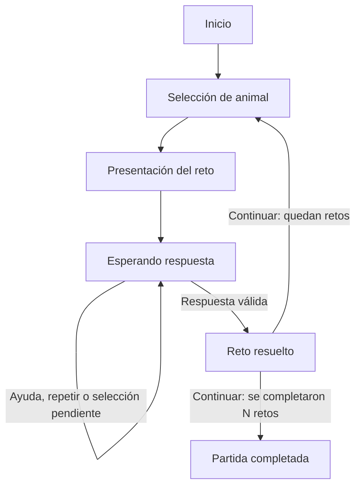

# Animales y hábitats: formalización del agente

Diseño propuesto · Versión 1 · 9 de octubre de 2026

Esta sección define el espacio de estados, las acciones permitidas, las reglas de transición y las condiciones de finalización del juego. Se apoya en el catálogo de 48 animales, las ocho categorías de hábitat y los tres niveles de ayuda ya preparados.

## 1. Unidad de juego y configuración

Un reto consiste en relacionar un animal con uno de sus hábitats confirmados. Una partida reúne N retos; N es un parámetro de configuración, con 1 ≤ N ≤ 48. El número de retos por partida no cambia la disponibilidad del catálogo: en la modalidad que inicia el jugador se mantienen disponibles los 48 animales.

Los escenarios se organizan en un banco preconfigurado. Cada escenario identifica al animal, su hábitat de referencia para las pistas, sus asociaciones confirmadas y sus mensajes de ayuda. El banco dispone inicialmente de un escenario general por animal.

La modalidad permanece fija durante la partida:

- **AGENTE:** el agente selecciona un escenario del banco y presenta la pregunta en pictogramas.
- **JUGADOR:** el jugador elige un animal; el agente recupera su escenario y comienza la guía.

Una respuesta válida completa un reto. Para iniciar el siguiente, el jugador pulsa «Continuar». Al alcanzar N retos completados, ese mismo control permite mostrar el cierre de la partida. Repetir un animal en un reto nuevo está permitido como práctica; un mismo reto resuelto solo se contabiliza una vez.

## 2. Conjuntos y base de conocimiento

Se definen los siguientes conjuntos:

- **X = {A01, …, A48}:** animales del catálogo.
- **H = {H01, …, H08}:** categorías de hábitat.
- **L = {0, 1, 2, 3}:** niveles de ayuda; 0 corresponde a una pregunta sin pistas.
- **M = {AGENTE, JUGADOR}:** modalidades de inicio.
- **⊥:** ausencia de un valor, por ejemplo antes de elegir un animal.

| ID | Hábitat |
|---|---|
| H01 | Selva tropical |
| H02 | Sabana |
| H03 | Desierto cálido |
| H04 | Mar |
| H05 | Bosque templado |
| H06 | Agua dulce |
| H07 | Regiones polares |
| H08 | Alta montaña |

La base de conocimiento contiene dos conjuntos de asociaciones:

- **V ⊆ X × H:** relaciones confirmadas como válidas. Incluye las asociaciones de referencia y las adicionales verificadas.
- **I ⊆ X × H:** relaciones expresamente verificadas como incorrectas dentro del alcance del juego.

V e I deben ser disjuntos. Toda asociación que no pertenece a ninguno se mantiene pendiente.

La función de evaluación es:

$$
C(x,h)=
\begin{cases}
\mathrm{VALIDA}, & (x,h)\in V\\
\mathrm{INCORRECTA}, & (x,h)\in I\\
\mathrm{PENDIENTE}, & (x,h)\notin V\cup I
\end{cases}
$$

En la matriz actual hay 69 asociaciones confirmadas como válidas y 315 pendientes. Todavía no se ha construido el conjunto de asociaciones incorrectas: inicialmente I = ∅. Por eso la transición correspondiente a una respuesta incorrecta se especifica aquí, pero no se activará utilizando una celda «?» como si fuera evidencia negativa.

Para cada animal x se define:

- **V(x):** conjunto de sus hábitats confirmados.
- **ref(x):** hábitat de referencia usado por la secuencia inicial de pistas.
- **P(x,l):** pista preparada para x en el nivel l, con l ∈ {1,2,3}.

Siempre debe cumplirse ref(x) ∈ V(x).

Ejemplo: para la capibara o ronsoco, V(A31) = {H01, H02, H06} y ref(A31) = H06. Las pistas orientan hacia agua dulce, pero las tres asociaciones se aceptan en una pregunta general.

## 3. Variables que forman un estado

Un estado contiene toda la información necesaria para decidir cómo continuar el juego:

$$
s=(m,f,x,g,l,h,r,c,f_{\mathrm{prev}},u)
$$

| Variable | Significado | Valores |
|---|---|---|
| m | Modalidad elegida para la partida. | AGENTE, JUGADOR o ⊥ antes de comenzar. |
| f | Fase actual de interacción. | Una de las ocho fases descritas abajo. |
| x | Animal del reto actual. | A01–A48 o ⊥. |
| g | Hábitat hacia el que orientan las pistas. | H01–H08 o ⊥; inicialmente g = ref(x). |
| l | Nivel de ayuda alcanzado en el reto. | 0, 1, 2 o 3. |
| h | Último hábitat seleccionado por el jugador. | H01–H08 o ⊥. |
| r | Evaluación de la última selección. | SIN_RESPUESTA, VALIDA, INCORRECTA o PENDIENTE. |
| c | Número de retos completados en esta partida. | Entero entre 0 y N. |
| f_prev | Fase a la que se debe volver después de una pausa. | SELECCION_ANIMAL, PRESENTACION, ESPERANDO_RESPUESTA, RETO_RESUELTO o ⊥. |
| u | Último contenido educativo presentado. | Identificador de pregunta, pista, confirmación o mensaje neutral; ⊥ antes de presentar contenido educativo. |

N, el banco de escenarios, las asociaciones y el catálogo de pistas son configuración de la partida, no valores que se cambien al pulsar «Ayuda».

La fase por sí sola no es el estado completo. Dos situaciones pueden estar en ESPERANDO_RESPUESTA, pero requerir ayudas distintas porque presentan animales diferentes o niveles de pista diferentes.

u permite reproducir el contenido actual sin alterar el progreso. La pausa se muestra como una capa de navegación y conserva ese contenido educativo.

## 4. Fases del juego

| Fase | Qué sucede | Qué puede hacer el jugador |
|---|---|---|
| INICIO | La partida todavía no ha comenzado. | Elegir modalidad e iniciar; salir. |
| SELECCION_ANIMAL | Se determina el animal del siguiente reto. | En modalidad JUGADOR, elegir entre los 48; pausar o salir. En modalidad AGENTE, esperar la elección del sistema. |
| PRESENTACION | El agente presenta el animal y la pregunta mediante pictogramas. | Pausar o salir; la selección de hábitat comienza al terminar esta preparación. |
| ESPERANDO_RESPUESTA | El reto está activo y se muestran los ocho hábitats. | Seleccionar un hábitat, pedir ayuda, repetir, pausar o salir. |
| RETO_RESUELTO | Se ha aceptado una asociación confirmada. | Leer o escuchar la confirmación, repetir, continuar, pausar o salir. |
| PAUSADA | La interacción del reto está suspendida. | Reanudar o salir. |
| COMPLETADA | Se ha mostrado el cierre después de resolver los N retos. | Iniciar otra partida mediante una nueva inicialización, si lo desea. |
| ABANDONADA | El jugador ha salido antes del cierre normal. | Iniciar otra partida mediante una nueva inicialización, si lo desea. |

COMPLETADA y ABANDONADA son estados terminales de la partida actual. Una nueva partida se crea a partir de un nuevo estado inicial.

Las ocho opciones se mantienen visibles y seleccionables mientras el reto está en ESPERANDO_RESPUESTA. Después de resolverlo, las selecciones de hábitat ya no modifican ese reto; el control disponible para avanzar es «Continuar».

## 5. Espacio de estados S

Sea F el conjunto de las ocho fases y R el conjunto de resultados de evaluación. El espacio de estados es el conjunto de tuplas alcanzables y coherentes:

$$
S\subseteq
(M\cup\{\bot\})\times F\times(X\cup\{\bot\})
\times(H\cup\{\bot\})\times L\times(H\cup\{\bot\})
\times R\times\{0,\ldots,N\}\times(F\cup\{\bot\})
\times(U\cup\{\bot\})
$$

U es el conjunto de identificadores del contenido educativo del banco: preguntas, pistas, confirmaciones y respuestas neutrales. Aunque el producto permite numerosas combinaciones, solo se admiten las que respetan las siguientes condiciones:

1. Antes de iniciar, m = ⊥, x = ⊥, g = ⊥, h = ⊥, l = 0 y c = 0.
2. En SELECCION_ANIMAL todavía no existe un animal del nuevo reto: x = g = h = ⊥ y l = 0.
3. En PRESENTACION, ESPERANDO_RESPUESTA y RETO_RESUELTO existe un animal x y g = ref(x).
4. En RETO_RESUELTO, r = VALIDA y h ∈ V(x).
5. En COMPLETADA, c = N.
6. En PAUSADA, f_prev conserva una fase no terminal y se preservan el animal, el nivel, la selección, el resultado, el progreso y el contenido.
7. Fuera de PAUSADA, f_prev = ⊥.
8. En SELECCION_ANIMAL, PRESENTACION y ESPERANDO_RESPUESTA se cumple c < N; en RETO_RESUELTO se cumple 1 ≤ c ≤ N.
9. El nivel de ayuda nunca supera 3 y el progreso nunca supera N.

El historial de interacción puede almacenarse aparte para analizar el funcionamiento o desarrollar la política adaptativa. No se necesita incluir una lista ilimitada de eventos dentro de esta representación básica del estado.

## 6. Acciones y responsabilidades

El espacio A incluye las entradas del jugador y los eventos internos que permiten preparar un reto:

| Acción | Quién la ejecuta | Cuándo está permitida |
|---|---|---|
| iniciar(m) | Jugador o configuración inicial de la interfaz. | INICIO, con una modalidad válida. |
| elegir_animal(x) | Jugador. | SELECCION_ANIMAL y m = JUGADOR. |
| generar_reto(x) | Agente. | SELECCION_ANIMAL y m = AGENTE; x pertenece al banco. |
| presentar_reto | Agente. | PRESENTACION. |
| seleccionar_habitat(h) | Jugador. | ESPERANDO_RESPUESTA. |
| ayuda | Jugador. | ESPERANDO_RESPUESTA. |
| repetir | Jugador. | ESPERANDO_RESPUESTA o RETO_RESUELTO. |
| continuar | Jugador. | RETO_RESUELTO. |
| pausar | Jugador. | SELECCION_ANIMAL, PRESENTACION, ESPERANDO_RESPUESTA o RETO_RESUELTO. |
| reanudar | Jugador. | PAUSADA. |
| salir | Jugador. | Cualquier fase no terminal. |

Además, el agente produce respuestas: presentar una pregunta, confirmar una asociación, entregar una pista, responder de forma neutral, esperar o mostrar el cierre.

Estas respuestas se representan mediante una función de salida O(s,a). La evaluación y la confirmación que siguen a una selección se consideran parte de la misma interacción: no se contabiliza un segundo reto por emitir la confirmación.

Una entrada no permitida para la fase actual no cambia el estado ni el progreso. Por ejemplo, pulsar otra vez un hábitat después de resolver el reto no completa un segundo reto.

## 7. Función de transición T

La transición transforma el estado actual a partir de una acción válida:

$$
T:S\times A\rightarrow S,\qquad s'=T(s,a)
$$

Cada transición conserva las variables que no se indican como modificadas.

| Estado o condición actual | Acción | Cambios principales | Nueva fase | Respuesta del agente |
|---|---|---|---|---|
| INICIO | iniciar(m) | Guardar modalidad; c = 0; limpiar el reto y el contenido. | SELECCION_ANIMAL | Mostrar el catálogo al jugador o comenzar la elección automática. |
| SELECCION_ANIMAL, modalidad JUGADOR | elegir_animal(x) | x = animal elegido; g = ref(x); l = 0; h = ⊥; r = SIN_RESPUESTA; u = ⊥. | PRESENTACION | Preparar el escenario del animal. |
| SELECCION_ANIMAL, modalidad AGENTE | generar_reto(x) | Los mismos cambios de preparación del animal. | PRESENTACION | Preparar el escenario seleccionado por el agente. |
| PRESENTACION | presentar_reto | u = pregunta inicial del animal. | ESPERANDO_RESPUESTA | Presentar la consulta en pictogramas y los ocho hábitats, con apoyo de voz. |
| ESPERANDO_RESPUESTA, C(x,h) = VALIDA | seleccionar_habitat(h) | Guardar h; r = VALIDA; c = c + 1; conservar l; u = confirmación de la asociación. | RETO_RESUELTO | Confirmar y explicar el contexto de la respuesta, cuando sea necesario. |
| ESPERANDO_RESPUESTA, C(x,h) = INCORRECTA | seleccionar_habitat(h) | Guardar h; r = INCORRECTA; l = min(l + 1,3); u = invitación breve y pista de ese nivel. | ESPERANDO_RESPUESTA | «Probemos otra opción» y la siguiente pista. |
| ESPERANDO_RESPUESTA, C(x,h) = PENDIENTE | seleccionar_habitat(h) | Guardar h; r = PENDIENTE; conservar l y c; u = respuesta neutral. | ESPERANDO_RESPUESTA | Ofrecer explorar una asociación confirmada y permitir pedir ayuda. |
| ESPERANDO_RESPUESTA | ayuda | l = min(l + 1,3); u = pista correspondiente; conservar selección, resultado y progreso. | ESPERANDO_RESPUESTA | Mostrar la siguiente pista o repetir la tercera cuando l ya era 3. |
| ESPERANDO_RESPUESTA o RETO_RESUELTO | repetir | Ningún cambio en las variables. | La misma | Reproducir u; no aumentar el nivel. |
| RETO_RESUELTO, c < N | continuar | x = g = h = ⊥; l = 0; r = SIN_RESPUESTA; u = ⊥; conservar modalidad y c. | SELECCION_ANIMAL | Preparar la elección del siguiente animal según la modalidad. |
| RETO_RESUELTO, c = N | continuar | Conservar el registro del último reto; u = cierre de partida. | COMPLETADA | Mostrar el cierre. |
| Fase no terminal permitida para pausa | pausar | f_prev = f; conservar las demás variables. | PAUSADA | Mostrar la pausa, sin evaluar selecciones. |
| PAUSADA | reanudar | f = f_prev; f_prev = ⊥; conservar las demás variables. | La fase anterior | Restaurar la misma situación de interacción. |
| Cualquier fase no terminal | salir | f_prev = ⊥; conservar el registro disponible. | ABANDONADA | Finalizar voluntariamente la partida. |
| ESPERANDO_RESPUESTA, sin interacción | Ninguna acción | Ningún cambio. | La misma | Esperar. |
| Acción fuera de su fase permitida | Cualquier entrada no permitida | Ningún cambio. | La misma | Mantener la pantalla y el estado. |

La ausencia de interacción describe la espera del sistema; no se interpreta como una acción de respuesta ni como un error.

Para ayuda o una respuesta incorrecta validada:

$$
l'=\min(l+1,3)
$$

Para una respuesta válida:

$$
c'=c+1
$$

Este incremento solo está permitido desde ESPERANDO_RESPUESTA. Después, la fase pasa a RETO_RESUELTO y queda bloqueado un nuevo incremento para ese mismo reto.

## 8. Estado inicial, objetivo y finalización

El estado inicial es:

$$
s_0=(\bot,\mathrm{INICIO},\bot,\bot,0,\bot,
\mathrm{SIN\_RESPUESTA},0,\bot,\bot)
$$

La configuración contiene N y el banco de escenarios antes de ejecutar iniciar(m).

### Resolución de un reto

Un reto se considera resuelto cuando:

$$
f=\mathrm{RETO\_RESUELTO}\quad\land\quad h\in V(x)
$$

El nivel de ayuda alcanzado no impide resolver el reto.

### Objetivo de la partida

La partida alcanza su cierre normal cuando se han completado N retos y el jugador continúa desde la última confirmación:

$$
G=\{s\in S\mid f=\mathrm{COMPLETADA}\land c=N\}
$$

Tras resolver el último reto, RETO_RESUELTO permite leer o escuchar la confirmación antes del cierre.

### Finalización voluntaria

Si el jugador ejecuta salir antes de ese cierre, la partida termina en ABANDONADA. Esto no produce una afirmación sobre su capacidad ni transforma sus respuestas en errores.

La pausa no termina la partida. Las asociaciones pendientes, los nuevos intentos y el uso de pistas tampoco la terminan.

COMPLETADA y ABANDONADA son terminales para la partida actual. Cualquier nueva partida comienza con una nueva inicialización en s₀.

## 9. Ciclo principal

El diagrama resume el ciclo de retos. La pausa y la salida se detallan en la tabla de transiciones.

La selección del animal corresponde al agente o al jugador según la modalidad. Una asociación incorrecta validada también regresa a ESPERANDO_RESPUESTA con el nivel de ayuda actualizado.

## 10. Ejemplo de una partida

Para ilustrar las transiciones se utiliza N = 2. Es un valor de ejemplo, no una cantidad obligatoria para todas las partidas.

Modalidad: JUGADOR.

| Paso | Acción o evento | Fase después del paso | Animal | Ayuda l | Retos completados c |
|---|---|---|---|---|---|
| 0 | Estado inicial. | INICIO | — | 0 | 0 |
| 1 | iniciar(JUGADOR). | SELECCION_ANIMAL | — | 0 | 0 |
| 2 | Elegir capibara, A31. | PRESENTACION | Capibara | 0 | 0 |
| 3 | El agente presenta el reto. | ESPERANDO_RESPUESTA | Capibara | 0 | 0 |
| 4 | Pedir ayuda. | ESPERANDO_RESPUESTA | Capibara | 1 | 0 |
| 5 | Seleccionar selva tropical, H01. | RETO_RESUELTO | Capibara | 1 | 1 |
| 6 | Pulsar «Continuar». | SELECCION_ANIMAL | — | 0 | 1 |
| 7 | Elegir pingüino emperador, A39. | PRESENTACION | Pingüino emperador | 0 | 1 |
| 8 | El agente presenta el reto. | ESPERANDO_RESPUESTA | Pingüino emperador | 0 | 1 |
| 9 | Seleccionar mar, H04. | RETO_RESUELTO | Pingüino emperador | 0 | 2 |
| 10 | Pulsar «Continuar». | COMPLETADA | Pingüino emperador | 0 | 2 |

En el primer reto, la guía de la capibara apunta a agua dulce, pero selva tropical es una asociación confirmada y se acepta. En el segundo, mar es una asociación confirmada para el pingüino emperador. La partida se completa sin exigir las categorías de referencia como únicas respuestas.

### Situaciones de comprobación para la futura PoC

| Situación | Comportamiento que deberá observarse |
|---|---|
| Cuatro solicitudes consecutivas de ayuda. | Niveles 1, 2, 3 y 3; el cuarto pedido repite la tercera pista. |
| Repetir una pista. | Misma fase, animal, nivel y progreso. |
| Elegir una asociación adicional confirmada. | Reto resuelto igual que con la asociación de referencia. |
| Elegir una asociación pendiente. | Respuesta neutral; nivel y progreso conservados. |
| Pausar y reanudar con ayuda de nivel 2. | Se vuelve al mismo animal y al nivel 2. |
| Seleccionar otra vez después de resolver. | El reto no se contabiliza nuevamente. |
| Continuar tras el último reto. | Cierre normal, sin generar otro animal. |
| Salir durante un reto. | Finalización voluntaria. |

Estas son situaciones de aceptación del diseño; todavía no representan pruebas ejecutadas sobre un programa.

## 11. Relación con el motor de razonamiento

Esta formalización define qué situaciones existen, qué acciones son legales y qué condiciones debe respetar el agente. El motor de razonamiento utilizará la información del estado para decidir sus intervenciones dentro de esas restricciones.

La secuencia inicial de ayuda sigue la regla l' = min(l + 1,3). Es una política de referencia para revisar el comportamiento. El proyecto todavía necesita definir e implementar el baseline de IA y el modelo principal exigidos por el enunciado. Este documento no afirma que esas técnicas ya estén desarrolladas.

La selección de escenarios y el contenido de las intervenciones son puntos donde se podrá incorporar la política de decisión. Para que una técnica seleccione entre distintas pistas del mismo nivel será necesario disponer de variantes de contenido respaldadas y definir sus atributos. El catálogo actual contiene una secuencia de tres pistas por animal.

## 12. Referencias de trabajo

- Enunciado del curso: TP-TF-1ASI0404-Enunciado - 2026-20.pdf, apartado de formalización del espacio de estados y reglas del juego.
- Matriz de trabajo: matriz_animales_habitats_48.md, consultada el 9 de octubre de 2026.
- Estrategia de ayuda: pistas_progresivas_animales_48.md, consultada el 9 de octubre de 2026.

Los identificadores A01–A48 y H01–H08 conservan el mismo significado que en los dos archivos de trabajo.

