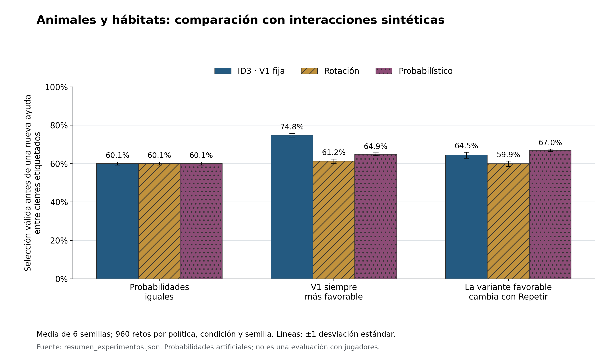

# Animales y hábitats: aprendizaje y comparación sintética

Versión 2.0.0 · 9 de octubre de 2026.

Se ejecutó el aprendizaje del selector de ayudas con Thompson Sampling y se evaluó el modelo congelado frente a ID3 y rotación. Los resultados proceden exclusivamente del jugador sintético configurado.

## 1. Diseño del experimento

Cada condición utilizó 6 réplicas. Por condición y réplica se simularon 1,920 retos de entrenamiento y 960 retos de evaluación por política. Cada réplica entrenó su propio modelo; ninguno utilizó las etiquetas de evaluación.

El mismo catálogo y las mismas reglas se ejecutaron con el gestor compartido. Los 48 animales se programaron por igual. Las modalidades de inicio se alternaron al comenzar nuevas sesiones; las ocho opciones se conservaron en los retos activos.

Los sorteos de evaluación se indexaron por semilla, reto, número de ayuda y tipo de evento. Así, las políticas compartieron los sorteos exógenos correspondientes. Cuando sus respuestas difieren, también pueden diferir las ayudas y contextos alcanzados: el indicador agregado describe cada política completa y no un efecto aislado de una variante.

| Condición | b = 0: V1 / V2 / V3 | b = 1: V1 / V2 / V3 |
|---|---|---|
| SIM_UNIFORME | 60% / 60% / 60% | 60% / 60% / 60% |
| SIM_DIFERENCIAS | 75% / 55% / 45% | 75% / 55% / 45% |
| SIM_CONTEXTUAL | 75% / 55% / 45% | 55% / 75% / 45% |

Estas probabilidades son parámetros artificiales de la señal y entre cierres etiquetados. No se extrajeron de personas. El uso de Repetir antes de la pista determina b; repetir después conserva el contexto original de esa pista y afecta a ayudas posteriores.

Se configuró 40% de repetición de la pregunta, 15% de repetición de una ayuda, 8% de pausa, 2% de salida y 4% de selección pendiente por oportunidad correspondiente. Los cierres pendientes y las salidas son independientes de la variante en este simulador.

El tope de 30 ayudas protege la ejecución sintética. Un corte cierra sin etiqueta; este tope no se aplica al jugador en la consola. Se observaron 0 cortes en evaluación.

## 2. Resultados de evaluación

Los porcentajes siguientes son medias de 6 réplicas. La variación presentada es la desviación estándar entre semillas, no un intervalo de confianza.

| Condición | Política | y = 1 entre etiquetadas | Sin etiqueta | Retos completados | Ayudas por reto completado |
|---|---|---:|---:|---:|---:|
| SIM_UNIFORME | ID3 | 60.12% ± 0.83 pp | 5.91% | 96.60% | 1.71 |
| SIM_UNIFORME | ROTACION | 60.12% ± 0.83 pp | 5.91% | 96.60% | 1.71 |
| SIM_UNIFORME | PROBABILISTICO | 60.12% ± 0.83 pp | 5.91% | 96.60% | 1.71 |
| SIM_DIFERENCIAS | ID3 | 74.82% ± 0.96 pp | 5.94% | 97.27% | 1.38 |
| SIM_DIFERENCIAS | ROTACION | 61.22% ± 1.23 pp | 5.95% | 96.65% | 1.68 |
| SIM_DIFERENCIAS | PROBABILISTICO | 64.90% ± 0.76 pp | 5.97% | 96.88% | 1.59 |
| SIM_CONTEXTUAL | ID3 | 64.45% ± 1.57 pp | 5.86% | 96.91% | 1.60 |
| SIM_CONTEXTUAL | ROTACION | 59.95% ± 1.45 pp | 5.93% | 96.56% | 1.71 |
| SIM_CONTEXTUAL | PROBABILISTICO | 66.96% ± 0.68 pp | 6.00% | 97.00% | 1.54 |

Figura 1. Porcentaje de y = 1 entre cierres etiquetados. Barras: media entre réplicas; líneas: una desviación estándar entre semillas. Fuente: ejecuciones registradas en resumen_experimentos.json. Datos sintéticos.

### Diferencias pareadas del modelo probabilístico

| Condición | Comparador | Diferencia media | Desviación entre diferencias |
|---|---|---:|---:|
| SIM_UNIFORME | ID3 | +0.00 pp | 0.00 pp |
| SIM_UNIFORME | ROTACION | +0.00 pp | 0.00 pp |
| SIM_DIFERENCIAS | ID3 | -9.92 pp | 0.82 pp |
| SIM_DIFERENCIAS | ROTACION | +3.68 pp | 0.80 pp |
| SIM_CONTEXTUAL | ID3 | +2.51 pp | 1.36 pp |
| SIM_CONTEXTUAL | ROTACION | +7.01 pp | 0.87 pp |

Estas diferencias son descriptivas para las semillas ejecutadas; no se realizó una prueba de significación ni una evaluación pedagógica.

## 3. Cómo interpretar las condiciones

- Uniforme: todas las variantes tienen la misma probabilidad configurada. Las diferencias observadas pueden proceder de los sorteos; aprender una preferencia no crea una ventaja real en esta condición.
- Diferencias constantes: V1 es la mejor variante configurada en ambos valores de b. ID3 conserva V1, mientras que el modelo probabilístico excluye la última forma cuando existen alternativas. Esta restricción puede reducir su resultado frente al baseline.
- Contextual: la variante más favorable cambia de V1 a V2 al cambiar b. La comparación permite revisar si el selector aprendido responde a esa diferencia, dentro de la restricción de variedad.

El diagnóstico también guarda la brecha frente a la mejor variante elegible y el coste de excluir la mejor variante global. Son cálculos sobre probabilidades conocidas del simulador, no medidas de comprensión. La variedad por sí sola no demuestra una mejora.

## 4. Cobertura y denominadores

| Condición | Política | Retos iniciados | Cierres etiquetados | Cierres sin etiqueta | Nuevas ayudas |
|---|---|---:|---:|---:|---:|
| SIM_UNIFORME | ID3 | 5760 | 9257 | 582 | 9839 |
| SIM_UNIFORME | ROTACION | 5760 | 9257 | 582 | 9839 |
| SIM_UNIFORME | PROBABILISTICO | 5760 | 9257 | 582 | 9839 |
| SIM_DIFERENCIAS | ID3 | 5760 | 7490 | 473 | 7963 |
| SIM_DIFERENCIAS | ROTACION | 5760 | 9097 | 575 | 9672 |
| SIM_DIFERENCIAS | PROBABILISTICO | 5760 | 8599 | 546 | 9145 |
| SIM_CONTEXTUAL | ID3 | 5760 | 8665 | 539 | 9204 |
| SIM_CONTEXTUAL | ROTACION | 5760 | 9282 | 585 | 9867 |
| SIM_CONTEXTUAL | PROBABILISTICO | 5760 | 8344 | 533 | 8877 |

La tasa principal es y1 / (y0 + y1). La proporción sin etiqueta usa (y0 + y1 + sin_etiqueta) como denominador. La proporción de retos completados utiliza todos los retos iniciados. La media de ayudas por reto completado excluye los retos abandonados; ayudas por reto iniciado se conserva por separado en el JSON.

Las medias por semilla dan el mismo peso a cada réplica. Los conteos de la tabla se suman entre réplicas. El desglose por hábitat, nivel, b y variante se guarda en las corridas individuales. Los contextos de nivel alto pueden recibir menos observaciones porque una selección válida termina antes el reto.

## 5. Comprobaciones de aprendizaje

Se guardaron 18 modelos entrenados. Cada modelo conserva sus 144 distribuciones, conteos de etiquetas, semillas y procedencia. Las actualizaciones de α y β suman únicamente cierres etiquetados de entrenamiento.

El menor número de distribuciones con alguna etiqueta por modelo fue 144 de 144. El mínimo de etiquetas en una distribución fue 1. Tener cobertura no implica tener estimaciones precisas: algunas variantes de niveles altos recibieron pocos resultados.

El registro distingue entrenamiento y evaluación. Las selecciones pendientes, las salidas, las pausas y Repetir no se utilizan como errores. Una observación duplicada no produce otra actualización y un cierre sin etiqueta no puede recibir una etiqueta retroactiva.

Los modelos de evaluación se cargan como tablas de parámetros inmutables. Se comprobó que su contenido no cambia durante cada corrida. Los resultados de la evaluación no se incorporan al entrenamiento ni se utilizan para elegir una semilla ganadora.

## 6. Archivos de evidencia

- resumen_experimentos.json: configuración, resultados agregados, diferencias pareadas y huellas de modelos.
- corridas/: métricas y cobertura por contexto de cada ejecución.
- modelos/: posteriores aprendidas por condición y réplica.
- observaciones_*.jsonl.gz: cierres, decisiones y procedencia; pueden leerse con gzip de Python.
- Las historias de entrenamiento y los ejemplos de decisiones se conservan en las corridas.

## 7. Límites y continuidad

Las probabilidades artificiales no varían por animal ni por nivel, aunque el modelo mantenga esos contextos separados. El simulador no representa comprensión, fatiga, accesibilidad ni aprendizaje duradero. La generalización que se comprueba es a nuevos sorteos del mismo entorno sintético.

La representación visual, la selección por clic o toque y la voz siguen pendientes. Este paquete desarrolla el aprendizaje y la comparación de la PoC; no constituye la entrega final completa del curso.

## 8. Redacción para el documento técnico

Se implementó un simulador de interacciones sintéticas sobre el núcleo compartido del juego. El entrenamiento utilizó Thompson Sampling para explorar variantes elegibles y actualizó distribuciones Beta–Bernoulli exclusivamente con observaciones etiquetadas. Se ejecutaron 34,560 retos de entrenamiento y 51,840 de evaluación, distribuidos en 3 condiciones y 6 réplicas. La evaluación se realizó con parámetros congelados y semillas separadas.

La comparación conservó ID3 con presentación fija, rotación de variantes y selección probabilística. El indicador principal fue la proporción de selecciones válidas antes de una nueva ayuda entre los cierres etiquetados. Los cierres pendientes y las salidas se informaron por separado. Las condiciones permiten observar igualdad de resultados, ventajas de una presentación fija y ventajas del selector contextual, sin asumir superioridad universal del modelo adaptativo.

Las conclusiones se limitan a las probabilidades artificiales del simulador. La cobertura por contexto, los parámetros aprendidos y los registros se conservaron para revisar la procedencia de cada decisión. La efectividad de las secuencias de pictogramas y la interacción accesible requerirán la implementación visual y una evaluación posterior.
